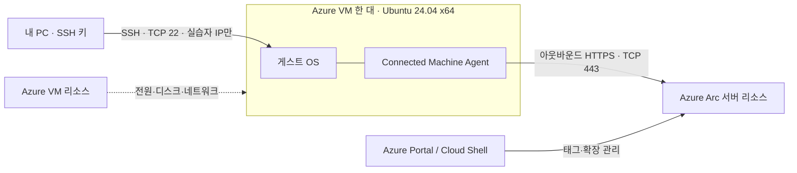

# 처음 시작하는 Azure Arc: Azure VM 한 대로 배우는 서버 관리

> Azure 밖의 장비가 없는 분을 위한 한국어 핸즈온입니다. **목표 시간 90분** 동안
> Ubuntu VM 한 대를 평가용 서버로 준비하고, Azure Arc 등록·태그·확장 관리를 경험한 뒤 정리합니다.

**처음이라면 [00. Azure Arc 첫걸음](docs/00-azure-arc-basics.md)부터 읽어보세요.**
로컬 컨테이너나 Kubernetes 환경은 필요하지 않습니다. Windows PC의 SSH와 Azure Portal을 사용합니다.

⚠️ **주의**

이 과정은 **평가·학습 전용**입니다. 일반 Azure VM은 Arc 없이도 관리할 수 있습니다.
Microsoft의 [Azure VM 평가 절차][evaluate]를 사용하며 운영용으로 지원되지 않습니다.
기존 업무용 VM에는 적용하지 마세요. 문서 작성·개선은 Azure 리소스 배포 승인이 아닙니다.

## 실습을 진행하는 방법

각 단계는 **👁️ 설명 → 🟢 실행 → 📋 확인** 순서로 읽습니다.
비용·보안·삭제·복구에 관한 조건은 **⚠️ 주의**로 따로 표시합니다.
개념을 배우는 부분에는 실행 명령이 없을 수 있습니다.

| 표시 | 해야 할 일 |
| --- | --- |
| 👁️ **설명** | 무엇을 왜 바꾸는지 이해합니다. |
| 🟢 **실행** | 표시된 위치에서 명령 블록 하나 또는 Portal 작업 하나를 수행합니다. |
| 📋 **확인** | 실제 출력·리소스·상태를 제시된 기준과 비교합니다. |
| ⚠️ **주의** | 비용, 관리 경로 손실, 잘못된 대상 삭제를 방지합니다. |

**명령 실행 위치가 세 곳으로 바뀝니다.** 참고 교재와 달리 모든 명령을 Cloud Shell에서 실행하지 않습니다.
이 실습은 Azure VM Guest Agent를 비활성화하므로 VM Run Command에 의존하지 않고 SSH를 유지합니다.

| 실행 위치 | 사용하는 작업 |
| --- | --- |
| **PC / PowerShell** | 내 Windows PC에서 SSH 접속·파일 복사 |
| **Ubuntu / Bash** | SSH로 접속한 VM 안에서 서비스·방화벽·Arc 에이전트 설정 |
| **Cloud Shell / Bash** | Portal의 Cloud Shell에서 Azure 구독·Arc 확장 관리 |
| **Portal** | 리소스 생성, 상태 확인, 태그와 삭제 작업 |

한 블록씩 실행하고 확인한 뒤 다음 블록으로 넘어갑니다.
실패하면 원인을 해결하거나 [정리 절차](docs/hands-on.md#cleanup)를 진행하세요.
출력 예시는 비교 기준이지 실제 성공 증거가 아닙니다.

### 실행 블록 읽는 법

| 표기 | 읽는 방법 |
| --- | --- |
| `<VM_PUBLIC_IP>` 같은 꺾쇠 값 | 자신의 실제 값으로 바꾸며 꺾쇠도 제거합니다. |
| `$VmPublicIp` | PC PowerShell의 변수입니다. Bash 변수와 공유되지 않습니다. |
| `$SUBSCRIPTION_ID` | 해당 Bash 세션의 변수입니다. 다른 창·새 세션에는 자동 전달되지 않습니다. |
| `sudo` | Ubuntu 안에서 관리자 권한으로 실행합니다. Azure RBAC 권한을 주는 명령은 아닙니다. |
| `&&` | 앞 명령이 성공한 경우에만 뒤 명령을 실행합니다. |
| `\|` | 앞 명령의 출력을 뒤 명령에 전달합니다. |
| 줄 끝 `\` | Bash에서 다음 줄까지 같은 명령입니다. 줄 끝에 다른 문자를 덧붙이지 않습니다. |
| `--query`, `-o json` | Azure CLI 결과의 선택 범위와 출력 형식을 정합니다. |

대부분의 명령은 종료 코드 0이 성공이지만, `command -v azcmagent`의 미설치 확인이나
`systemctl is-active`의 비활성 상태 확인에는 예외가 있습니다. 각 단계의 **확인**에서
예상한 출력과 종료 상태를 함께 읽으세요. 예외를 다른 실패에도 일괄 적용하지 않습니다.

## 무엇을 배우나요?

Azure Arc는 외부 서버를 Azure의 관리 대상으로 등록하는 기술입니다.
이번에는 별도 외부 장비 대신 **Azure VM을 평가용으로 준비**합니다.
그 안의 Connected Machine Agent를 통해 OS 정보와 연결 상태를 확인하고,
Custom Script 확장으로 파일을 만들어 실제 명령 실행까지 경험합니다.
등록·태그·확장이 각각 무엇을 검증하는지도 구분합니다.

## 구성 개요: 컴퓨터는 한 대, 관리 리소스는 두 개



한 서버가 Portal에 두 리소스로 보입니다. VM이 Azure 밖으로 이동하는 것은 아닙니다.

| 리소스 | 역할 |
| --- | --- |
| Azure VM: `Microsoft.Compute/virtualMachines` | 전원, CPU·메모리, 네트워크, 디스크 관리 |
| Arc 서버: `Microsoft.HybridCompute/machines` | 게스트 OS 정보, Arc 에이전트, 확장 관리 |

공인 IP의 SSH 경로는 사람이 VM을 준비하기 위한 것입니다.
Arc 에이전트의 HTTPS 경로는 Azure와 관리 정보를 교환하기 위한 것이며 서로 다른 경로입니다.
Arc 등록이 성공해도 SSH가 자동으로 열리는 것은 아닙니다.

## 모듈 목차

파일을 여러 개로 옮기지 않고, 이 README의 환경 준비와 상세 가이드의 실습을 연결했습니다.
**00 → 07** 순서로 진행하며 끝나거나 중단하면 반드시 07에서 정리합니다.

| # | 모듈 | 완료하면 할 수 있는 일 | 목표 시간 |
| --- | --- | --- | ---: |
| 00 | [Azure Arc 첫걸음](docs/00-azure-arc-basics.md) | 구독·RG·리전, Arc와 두 관리 리소스의 차이 설명 | 10분 |
| 01 | [시작 전 확인](#prerequisites) | 권한·공급자·정책·비용 확인 | 10분 |
| 02 | [전용 Ubuntu VM 만들기](#vm-create) | 실습용 VM·네트워크·SSH 키 준비 | 15분 |
| 03 | [SSH 접속 확인](#ssh-check) | OS·아키텍처·sudo와 관리 경로 확인 | 5분 |
| 04 | [평가 환경 준비](docs/hands-on.md#prepare) | VM 확장·Guest Agent·IMDS를 평가용으로 구성 | 15분 |
| 05 | [Arc 등록과 기본 관리](docs/hands-on.md#onboard) | Arc 연결·대상 ID·태그 확인 | 10분 |
| 06 | [Arc 확장 실습](docs/hands-on.md#extension-lab) | 실제 파일 생성과 확장 제거 검증 | 15분 |
| 07 | [정리와 운영 차이](docs/hands-on.md#cleanup) | Arc 등록과 실습 자원 삭제, 운영 전환 차이 설명 | 10분 |
| | **전체 목표** | | **90분** |

90분은 학습 진행 목표입니다. 리소스 배포·인증·정책 반영·삭제 대기에 따라 더 걸릴 수 있습니다.

<a id="prerequisites"></a>
## 1. 시작 전 확인

> 모듈 01 · 목표 10분. 아직 유료 자원을 만들지 않고 실습 가능한 조건부터 확인합니다.

👁️ **설명**

구독은 비용·권한의 경계이고, 리소스 그룹은 이번에 만들고 함께 삭제할 자원의 묶음입니다.
계정이 Portal에 로그인할 수 있다고 해서 VM 생성·Arc 등록·삭제 권한이 모두 있는 것은 아닙니다.
먼저 아래 조건을 확인하면 중간에 자원을 만든 채 막히는 일을 줄일 수 있습니다.

### 계정과 권한

- Azure 구독과 Azure Portal 접속 권한이 필요합니다.
- 전용 리소스 그룹 생성 및 VM·네트워크·디스크 생성 권한이 필요합니다.
  `Virtual Machine Contributor`만으로 리소스 그룹·네트워크 생성까지 모두 가능한 것은 아닙니다.
- Arc 등록에는 해당 리소스 그룹의 `Azure Connected Machine Onboarding`,
  Portal에서 그룹을 선택하려면 `Reader` 권한이 필요합니다.
- 이후 태그·확장 관리와 삭제에는 `Azure Connected Machine Resource Administrator`
  또는 이를 포함하는 권한이 필요합니다. 온보딩 전용 역할만으로는 실습 전체를 수행할 수 없습니다.
- 리소스 그룹 삭제 권한도 별도로 확인합니다. 온보딩에 구독 `Owner` 계정을 사용하는 대신
  관리자가 실습용 그룹과 필요한 역할을 준비하는 방식을 권장합니다.

🟢 **실행 — Portal**

실습에 사용할 구독과 전용 그룹에 대해 위 역할을 확인합니다.
Portal의 **구독 → 리소스 공급자(Resource providers)** 에서 다음을 확인합니다.
등록 권한이 없다면 관리자에게 요청하고 `Registered`가 될 때까지 기다립니다.

| 공급자 | 용도 |
| --- | --- |
| `Microsoft.Compute`, `Microsoft.Network` | VM과 네트워크 |
| `Microsoft.HybridCompute` | Arc 서버와 확장 |
| `Microsoft.GuestConfiguration` | Arc 필수 공급자 |
| `Microsoft.HybridConnectivity` | Arc 필수 공급자 |

공급자 등록 자체가 유료 기능 활성화는 아닙니다.
SQL Server 실습이 아니므로 `Microsoft.AzureArcData`는 이번에 등록할 필요가 없습니다.

📋 **확인**

필요한 생성·등록·관리·삭제 권한을 확보했고, 표의 공급자 상태가 `Registered`여야 합니다.
`Registering`이면 완료를 기다립니다. 권한 요청과 자원 생성은 다른 작업입니다.

⚠️ **주의**

**구독 정책과 자동 설치도 확인하세요.** Defender for Servers, Azure Monitor,
Update Manager, Essential Machine Management 등의 플랜·정책이 이미 적용되어 있다면
추가 과금이나 확장 재설치가 발생할 수 있습니다. 강제 정책을 임의 해제하지 말고,
관리자에게 별도 실습 구독 또는 승인된 예외를 요청합니다. 조정할 수 없다면 여기서 중단합니다.

### 비용과 배포 승인

👁️ **설명**

Arc의 기본 인벤토리·태그 관리와 Custom Script 실행은
[현재 기본 제어 영역 요금][pricing]에서 무료로 안내됩니다.
**실습 전체가 무료인 것은 아닙니다.** VM, OS 디스크, 공인 IPv4 주소, 일부 네트워크 사용은 과금됩니다.
모니터링·보안·업데이트 등 부가 서비스는 별도 요금이 생길 수 있어 이번 실습에서 활성화하지 않습니다.

🟢 **실행 — Portal**

다음을 먼저 확인하고 비용 부담을 승인한 뒤에만 VM의 **만들기(Create)** 를 누릅니다.

| 확인할 항목 | 확인 방법 |
| --- | --- |
| 구독과 리전 | 구독 정책·허용 리전, Arc 메타데이터 지원 리전 확인 |
| VM 크기 | 가벼운 단일 서버용 버스터블 B 계열과 일반 목적 D 계열 후보 비교 |
| 가용성과 할당량 | 선택 리전의 해당 SKU 가용성, 전체·제품군 vCPU 할당량 확인 |
| 예상 비용 | VM 생성 화면과 [가격 계산기][calculator]에서 실제 선택값 확인 |
| 실습 시간 | 사용할 시간과 종료·삭제 시점을 정하고 비용 추정에 반영 |

고정 SKU나 요금은 이 문서에서 보장하지 않습니다. Portal이 허용하는
**2 vCPU·4 GiB 수준의 작은 x64 후보부터** 비교하고, 메모리 부족 시 비용을 다시 확인합니다.
VM 가격만 보지 말고 디스크와 공인 IP도 합산하세요.
Cost Management 예산 알림은 지출을 강제로 막는 기능이 아닙니다.

📋 **확인**

- [ ] 사용할 구독·리전과 VM 후보의 가용성·할당량을 확인했습니다.
- [ ] VM·디스크·공인 IP의 예상 비용과 실습 종료 시점을 정했습니다.
- [ ] 자동 유료 기능·확장 설치 정책이 실습과 충돌하지 않는지 확인했습니다.
- [ ] 비용 부담을 승인했습니다. 확인 전에는 다음 절에서 배포하지 않습니다.

<a id="vm-create"></a>
## 2. 전용 Ubuntu VM 만들기

> 모듈 02 · 목표 15분. 다른 자원과 섞이지 않는 실습용 컴퓨터를 만듭니다.

👁️ **설명**

VM은 실행할 컴퓨터, OS 디스크는 운영체제와 파일이 저장될 장치입니다.
VNet·서브넷은 VM이 속한 네트워크, NIC는 네트워크 연결 장치, NSG는 IP·포트의 허용 규칙입니다.
이번에는 전용 그룹 하나에 묶어 나중에 같은 실습 자원만 정리하기 쉽게 합니다.
리소스 이름이 이미 존재하면 기존 것을 덮어쓰거나 재사용하지 말고 소유권부터 확인하세요.

🟢 **실행 — Portal**

Portal의 **가상 머신 → 만들기 → Azure 가상 머신**에서 다음을 지정합니다.
Portal UI 명칭은 표시 언어와 업데이트에 따라 달라질 수 있습니다.

| 항목 | 실습 설정 |
| --- | --- |
| 리소스 그룹 | 새 전용 그룹 `rg-arc-lab-01` |
| VM 이름 | `arc-lab-ubuntu-01` |
| 이미지 | Canonical Ubuntu Server **24.04 LTS**, **x64**, 일반 이미지 |
| VM 크기 | 앞에서 비용·할당량을 확인한 작은 크기 |
| 가용성 | 단일 VM. 별도 고가용성 리소스 없음 |
| 인증 | SSH 공개 키, 사용자 `arcadmin` |
| 디스크 | 기본 OS 디스크만 사용. 추가 데이터 디스크 없음 |
| VNet·서브넷 | 실습 전용 새 VNet·서브넷 |
| 공인 IP | 실습용 Standard 공인 IP 한 개, VM NIC에 연결 |
| NIC NSG | Advanced에서 실습용 새 NSG 구성 |
| SSH 인바운드 | TCP 22, **실습자 공인 IPv4 `/32`만** 허용 |
| 부가 관리 | 모니터링·자동 패치·Defender·백업·추가 확장을 새로 활성화하지 않음 |

⚠️ **주의**

**SSH를 `Any` 또는 `0.0.0.0/0`에 열지 마세요.**
기본 화면의 SSH 체크박스가 전체 인터넷 허용 규칙을 만들었다면 규칙을 제거하고,
고급 NSG 설정에서 소스 IP를 제한한 뒤 배포합니다.
회사 프록시·VPN 환경에서는 실제 SSH 트래픽의 공인 출구 IP를 관리자와 확인하세요.
IP가 바뀌면 NSG와 이후 Ubuntu 방화벽의 허용 IP도 갱신해야 합니다.

아웃바운드는 NIC에 직접 연결한 공인 IP를 사용합니다. 서브넷의 기본 아웃바운드가
자동으로 제공된다고 가정하지 않습니다. 강제 터널링·UDR·방화벽이 적용되어 있다면
DNS, Ubuntu 패키지 저장소와 [Arc 필수 HTTPS 엔드포인트][network] 접근을 먼저 확인합니다.
Arc 연결만을 위해 별도의 인바운드 포트를 열 필요는 없습니다.

Trusted Launch 등 보안 기본값을 무조건 해제하지 않습니다. 다만 자동으로
Guest Attestation 등의 확장이 설치되었다면, 다음 실습의 **확장 제거 단계**에서 확인해야 합니다.
정책이 확장을 계속 재설치하면 진행하지 말고 관리자와 확인하세요.

**검토 + 만들기**에서 비용과 선택값을 다시 확인하고, 승인했다면 배포합니다.
개인 키를 내려받았다면 안전한 사용자 폴더에 보관하세요.
키·토큰과 다운로드한 온보딩 스크립트를 이 Git 저장소에 복사하거나 커밋하지 않습니다.

📋 **확인 — Portal**

- [ ] 배포가 성공했고 VM이 실행 중이며 Ubuntu 24.04 x64를 선택했습니다.
- [ ] 이번 전용 그룹 안에 VM·OS 디스크·NIC·NSG·VNet·공인 IP가 있습니다.
- [ ] NIC에 연결된 NSG의 TCP 22 소스가 실습자 IP `/32`이며, 전체 인터넷 허용 규칙은 없습니다.
- [ ] SSH 개인 키를 안전한 사용자 폴더에 보관했습니다.

아직 Arc 머신이 없어도 정상입니다. 지금 생성한 것은 **Azure VM 리소스**입니다.

<a id="ssh-check"></a>
## 3. SSH 접속 확인

> 모듈 03 · 목표 5분. Arc 실습 전 사용할 유일한 직접 관리 경로를 확인합니다.

👁️ **설명**

SSH는 내 PC에서 Ubuntu의 명령줄에 접속하는 방법입니다.
공개 키는 VM에, 개인 키는 내 PC에 둡니다. 개인 키를 VM에 복사하지 않습니다.
다음 단계에서 Azure VM Guest Agent를 끄므로 **SSH가 되는지 먼저 확인하는 순서**가 중요합니다.

🟢 **실행 — PC / PowerShell**

VM 배포 후 Portal에서 공인 IP를 확인합니다.
다음 명령은 **내 Windows PC의 PowerShell**에서 실행합니다.
꺾쇠 부분을 실제 값으로 바꾸세요.

```powershell
$VmPublicIp = '<VM_PUBLIC_IP>'
$PrivateKeyPath = "$HOME\.ssh\<PRIVATE_KEY_FILE>"
ssh -i $PrivateKeyPath "arcadmin@$VmPublicIp"
```

예제 경로와 다른 폴더에 키를 저장했다면 실제 키 경로를 사용합니다.
첫 접속의 호스트 키 지문은 신뢰할 수 있는 관리 경로로 확인하고 수락합니다.
시간 초과라면 VM 전원, 공인 IP, NSG의 소스 `/32`, 회사 네트워크의 TCP 22 차단부터 확인합니다.
이를 해결하려고 SSH를 전체 인터넷에 개방하지 마세요.

🟢 **실행 — Ubuntu / Bash**

접속한 Ubuntu SSH 터미널에서 실행합니다. PC의 PowerShell 프롬프트와 혼동하지 마세요.

```bash
cat /etc/os-release
uname -m
sudo -v
```

📋 **확인**

| 확인 명령 | 기대 결과 | 의미 |
| --- | --- | --- |
| `cat /etc/os-release` | `VERSION_ID="24.04"` | 지원되는 Ubuntu 버전 |
| `uname -m` | `x86_64` | 이번 실습의 x64 아키텍처 |
| `sudo -v` | 오류 없이 돌아옴 | 시스템 설정을 바꿀 관리자 권한 |

여기까지는 Azure Linux Guest Agent나 메타데이터 접근을 변경하지 않습니다.
SSH 접속이 불안정하다면 다음 단계로 넘어가지 마세요.

이제 [Arc 등록·관리·정리 실습](docs/hands-on.md)으로 이동합니다.

## 세션이 끊겼을 때

| 끊긴 위치 | 이어가기 전에 할 일 |
| --- | --- |
| PC의 SSH | 같은 VM 공인 IP·개인 키로 다시 접속하고 NSG·UFW의 내 IP 허용 확인 |
| Ubuntu 셸 | [평가 변수와 방화벽](docs/hands-on.md#evaluation-settings) 재확인. 셸 변수는 새 창에 남지 않음 |
| VM 재부팅 | Guest Agent·방화벽·IMDS 차단을 재검증하고 평가 환경 변수 재설정 |
| Cloud Shell | [확장 실습의 공통 준비](docs/hands-on.md#cloud-shell-setup)에서 구독·그룹·머신·리전 변수 복원 |

다른 세션에서 새 VM이나 새 Arc 리소스를 만드는 것으로 재접속을 대신하지 않습니다.
이미 만든 자원의 상태부터 확인하고, 성공한 생성 명령을 무작정 반복하지 마세요.

## 비용과 정리

| 항목 | 이번 구성 | 정리할 때의 의미 |
| --- | --- | --- |
| VM 컴퓨팅 | Ubuntu 1대 | OS 종료와 Azure의 할당 해제는 다를 수 있음 |
| OS 디스크 | 1개 | VM 할당 해제 후에도 저장 비용이 남을 수 있음 |
| Standard 공인 IP | 1개 | 미사용 상태라고 무료라고 가정하지 않기 |
| Arc 기본 인벤토리·태그·Custom Script | 기본 제어 영역 | 기반 VM 요금과 부가 관리 서비스 요금은 별개 |
| Cloud Shell 지속 스토리지 | 만들지 않는 임시 세션 권장 | 별도 생성했다면 공유 여부 확인 후 따로 정리 |

**완료·실패 여부와 관계없이 [모듈 07의 정리](docs/hands-on.md#cleanup)를 확인하세요.**
이 가이드는 다른 사람이 사용하는 공유 리소스나 구독 전체를 삭제하지 않습니다.
운영 환경과 무엇이 다른지는 [운영 전환 대응표](docs/hands-on.md#production-differences)에서 확인합니다.

## 트러블슈팅

| 증상 | 확인할 위치 |
| --- | --- |
| Azure나 Arc 용어가 낯섦 | [00. Azure Arc 첫걸음](docs/00-azure-arc-basics.md) |
| 구독이 안 보이거나 생성·삭제 권한 부족 | [모듈 01: 시작 전 확인](#prerequisites) |
| SSH가 안 됨 | [모듈 03: SSH 확인](#ssh-check), [상세 오류 대응](docs/hands-on.md#troubleshooting) |
| 평가용 설치·Arc 연결·확장이 실패함 | [상세 오류 대응](docs/hands-on.md#troubleshooting) |
| 중도 실패했거나 비용이 걱정됨 | [모듈 07: 정리](docs/hands-on.md#cleanup) |

## 검증 상태와 참고

이 저장소는 실습 가이드입니다. **Azure 리소스를 배포해 끝까지 검증한 상태는 아닙니다.**
구독별 가격·정책·할당량과 Portal의 실제 표시값은 배포 전 확인해야 합니다.
실습을 중단해도 만든 리소스는 자동 삭제되지 않습니다.
사용하지 않을 때는 상세 가이드의 정리 절차를 수행하세요.
VM을 할당 해제해도 디스크·공인 IP 등의 비용은 남을 수 있습니다.

- [공식 평가 절차][evaluate]
- [지원 OS·권한·필수 공급자][prerequisites]
- [교재 형식 참고: ms-landing-zone-02](https://github.com/freeman9844/ms-landing-zone-02)
- [승인된 설계](docs/superpowers/specs/2026-11-11-azure-arc-server-lab-design.md)
- [구현 계획](docs/superpowers/plans/2026-11-11-azure-arc-server-lab.md)

참고 저장소의 단계 구분과 학습 흐름을 참고했으며 문장·코드·이미지는 복사하지 않았습니다.
기존 설계·계획은 최초 실습의 승인 기록이고, 현재 학습 순서의 진입점은 이 README입니다.

[evaluate]: https://learn.microsoft.com/en-us/azure/azure-arc/servers/plan-evaluate-on-azure-virtual-machine
[prerequisites]: https://learn.microsoft.com/en-us/azure/azure-arc/servers/prerequisites
[network]: https://learn.microsoft.com/en-us/azure/azure-arc/servers/network-requirements
[pricing]: https://azure.microsoft.com/en-us/pricing/details/azure-arc/
[calculator]: https://azure.microsoft.com/en-us/pricing/calculator/
