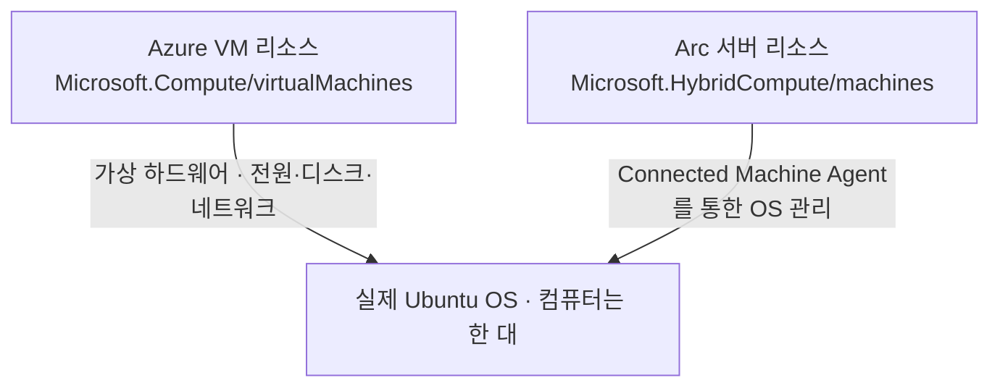

# 00. Azure Arc 첫걸음

> 목표 시간 10분. 서버를 만들기 전에 “어디서 실행되고, 무엇을 Azure로 관리하는가”를 구분합니다.
> 이 모듈에서는 자원을 생성하거나 비용이 발생하는 기능을 켜지 않습니다.

## 목표

- 구독·리소스 그룹·리전과 VM의 역할을 설명합니다.
- Azure Arc가 서버를 Azure로 이전하는 기능이 아님을 이해합니다.
- Azure VM과 Arc 서버가 두 리소스로 보이는 이유를 설명합니다.
- SSH·RBAC·방화벽·에이전트가 각각 해결하는 문제를 구분합니다.

## 1. 먼저 작은 서버 관리 상황을 생각해 보기

👁️ **설명**

회사에 Ubuntu 서버가 한 대 있고, 다른 클라우드에도 서버가 있다고 생각해 보세요.
서버마다 직접 접속해 OS 버전을 확인하거나 설정 명령을 실행하면 관리 방법이 흩어집니다.
Azure Arc-enabled servers는 이런 **Azure 외부의 Windows·Linux 서버를 Azure의 관리 대상으로
등록**하는 서비스입니다. 서버의 실행 위치를 바꾸지 않고 Portal에서 정보를 조회하고,
지원되는 확장으로 설정 작업을 수행하도록 연결합니다.

이번에는 외부 서버가 없으므로 Azure VM 한 대를 테스트용으로 준비합니다.
배우려는 것은 “Azure VM을 만드는 법”뿐 아니라 **외부 서버를 등록하고 관리하는 흐름**입니다.
실습 컴퓨터는 계속 Azure 안에 있고, 외부 서버처럼 보이도록 평가 전용 설정을 적용합니다.

⚠️ **주의**

일반 Azure VM에 Arc를 설치하는 것은 운영 권장 구성이 아닙니다.
이번 방식은 [Microsoft가 안내하는 Azure VM 평가 절차][evaluate]에 한정됩니다.
기존 업무용 VM 대신 지워도 되는 새 실습 VM을 사용합니다.

## 2. Azure에서 무엇을 어디에 만드나요?

👁️ **설명**

| 용어 | 쉽게 이해하기 | 이번 실습의 예 |
| --- | --- | --- |
| 테넌트(Tenant) | 계정·조직의 디렉터리 경계 | 실습 구독을 사용하는 Microsoft Entra 디렉터리 |
| 구독(Subscription) | 리소스 사용과 청구를 관리하는 경계 | 비용·할당량을 확인할 실습 구독 |
| 리소스 그룹(RG) | 관련 자원을 함께 관리하는 묶음 | `rg-arc-lab-01` |
| 리전(Region) | 서비스가 배치되거나 관리 정보를 보관하는 지역 | 배포 전 지원·가격을 확인한 지역 |
| 리소스(Resource) | Azure가 관리하는 개별 대상 | VM, 디스크, 공인 IP, Arc 서버 |

리소스 그룹의 리전은 그룹 메타데이터의 위치입니다.
그 안의 모든 리소스가 자동으로 같은 위치에 생성되는 것은 아닙니다.
특히 Arc 등록 화면에서 고르는 리전은 **Arc 서버의 관리 메타데이터 위치**입니다.
VM 실행 위치와 혼동하지 말고 이후 확장 작업에는 Arc 리전을 사용하세요.

한 컴퓨터를 만들더라도 VM, OS 디스크, NIC, NSG, VNet, 공인 IP가 별도 리소스로 생깁니다.
전용 그룹에 묶는 이유는 이름을 예쁘게 맞추기 위해서가 아니라 **삭제 대상을 분명히 하기 위해서**입니다.
그룹을 삭제하면 그 안의 자원도 삭제되므로 운영 자원과 섞지 않습니다.

📋 **확인**

“VM을 껐다”와 “그룹을 삭제했다”를 구분해 보세요.
VM이 꺼져도 디스크와 공인 IP는 남을 수 있고, 비용도 모두 멈춘다고 볼 수 없습니다.

## 3. 컴퓨터 한 대가 왜 두 리소스로 보일까요?

👁️ **설명**

평가 설정 후 Arc에 등록하면 한 Ubuntu VM에 대해 관리 대상이 두 개 생깁니다.

| 하고 싶은 일 | 이번 실습에서 열 대상 |
| --- | --- |
| VM 켜기·할당 해제, 디스크·공인 IP 확인 | **Azure VM 리소스** |
| Arc 연결 상태·OS 정보·Arc 에이전트 확인 | **Arc 서버 리소스** |
| 실습용 Custom Script 확장 설치·제거 | **Arc 서버의 확장** |
| Ubuntu 명령을 직접 실행해서 결과 확인 | **PC에서 SSH로 접속한 VM** |

Arc 서버 리소스를 삭제해도 이 실습의 Azure VM 컴퓨팅 리소스를 삭제하는 것은 아닙니다.
반대로 VM만 삭제하면 Arc 등록이 별도 리소스로 남을 수 있습니다.
그래서 정리할 때 **Arc 연결 해제와 실습 그룹 삭제를 모두 확인**합니다.

📋 **확인**

“Portal에서 확장을 설치하라”는 지시를 보면 먼저 Azure VM인지 Arc 서버인지 확인하세요.
이번 실습의 관리 검증은 **Arc 서버에 배포한 확장**으로 수행합니다.

## 4. 에이전트·SSH·권한은 서로 다른 역할입니다

👁️ **설명**

**에이전트(Agent)**는 서버 안에서 실행되며 관리 서비스와 통신하는 프로그램입니다.
Connected Machine Agent는 서버의 Azure 연결·ID와 확장 관리를 담당합니다.
**Azure Monitor Agent(AMA)**는 로그·성능 수집을 위한 별도 에이전트입니다.
Arc에 연결했다는 이유만으로 로그 수집이나 유료 관리 기능이 모두 켜지는 것은 아닙니다.
단, 구독 정책이 자동으로 켤 수 있으므로 실습 전에 확인합니다.

| 요소 | 답하는 질문 | 이번 실습의 역할 |
| --- | --- | --- |
| Azure RBAC | 누가 Azure 리소스를 관리할 수 있나? | Arc 등록, 태그·확장 변경, 삭제 권한 |
| SSH 키·Ubuntu 계정 | 누가 OS에 로그인할 수 있나? | 내 PC에서 `arcadmin`으로 VM 접속 |
| sudo | OS 안에서 관리자 작업을 할 수 있나? | 서비스·방화벽·에이전트 설치 |
| NSG | Azure 네트워크에서 어느 IP·포트를 허용하나? | 내 PC의 TCP 22만 허용 |
| UFW | Ubuntu OS에서 어느 통신을 허용하나? | SSH 허용 유지와 평가용 IMDS 차단 |
| Connected Machine Agent | 서버와 Azure의 관리 연결이 살아 있나? | 정보 동기화와 확장 관리 |

Azure 권한이 있다고 자동으로 SSH 개인 키를 얻는 것은 아닙니다.
NSG가 SSH를 허용해도 키가 맞지 않으면 로그인은 실패합니다.
반대로 SSH가 되어도 Arc 권한·아웃바운드 통신이 막히면 Arc 등록은 실패합니다.

⚠️ **주의**

Custom Script 확장은 OS에 관리자 권한으로 변경을 적용할 수 있는 기능입니다.
실습에서는 비밀이 없는 단순 파일만 생성합니다. 외부에서 받은 스크립트를 검토 없이 실행하지 않습니다.

## 5. 평가 설정에서 무엇을 바꾸나요?

👁️ **설명**

일반 Azure VM은 이미 Azure VM Guest Agent와 Azure 메타데이터 서비스를 사용합니다.
Arc도 자체 관리 연결과 ID를 사용하므로, 평가 환경에서 두 관리 방식을 그대로 함께 쓰지 않도록 준비합니다.

| 준비 작업 | 필요한 이유 | 주의할 영향 |
| --- | --- | --- |
| 기존 Azure VM 확장 제거 | Arc가 기존 Azure VM 확장을 인수해 관리하는 것은 아님 | 정책이 재설치하면 중단 |
| `walinuxagent` 중지·비활성화 | Azure VM Guest Agent와 Arc 관리 경로의 충돌 방지 | VM Run Command·VM 확장에 의존 불가 |
| Azure IMDS 접근 차단 | Azure VM의 메타데이터·관리 ID와 Arc의 관리 표현을 구분 | 기존 Azure VM 관리 ID 인증 사용 제한 |
| `MSFT_ARC_TEST=true` 설정 | Microsoft 평가용 절차에 필요한 테스트 환경 표시 | 현재 셸·systemd·sudo 전달과 재부팅 후 상태 확인 |

**IMDS(Instance Metadata Service)**는 VM이 자신의 위치·ID 등 메타데이터를 조회하는 서비스입니다.
평가 절차에서는 `169.254.169.254`와 `169.254.169.253` 접근을 차단합니다.
인터넷 전체나 Arc 통신을 막으라는 뜻은 아닙니다.
Connected Machine Agent는 별도의 로컬 메타데이터 서비스를 제공합니다.

이 변경은 컴퓨터의 CPU나 디스크를 다른 곳으로 옮기지 않습니다.
실제 온프레미스 서버를 연결할 때에는 Azure VM을 위한 이 우회 준비 단계를 그대로 적용하지 않습니다.

## 6. 무엇을 확인해야 실습 성공인가요?

👁️ **설명**

| 확인 대상 | 성공 기준 | 이것만으로 보장하지 않는 것 |
| --- | --- | --- |
| SSH | 새 SSH 창으로 접속 성공 | Arc 등록·확장 관리 성공 |
| Arc 연결 | 에이전트와 Portal에서 `Connected` | 모든 부가 서비스나 확장 성공 |
| 태그 | `lab=arc-test-01`이 저장됨 | 게스트 OS 안의 변경 |
| Custom Script 확장 | `Succeeded`와 VM 안의 `arc-lab-ok` 파일 | 운영 보안·성능·장애 복구 준비 완료 |
| 정리 | Arc 서버와 이번 실습의 VM·디스크·공인 IP 부재 | 과거 사용 요금의 취소 |

Arc는 서버 관리 수단이지 애플리케이션 네트워크를 연결하는 VPN이 아닙니다.
Arc에 등록했다고 서로 다른 서버 간 통신이나 SSH 인바운드가 자동 허용되지는 않습니다.
이번 실습은 관리 연결만 경험하며 온프레미스 전체 네트워크나 운영 보안 설계를 재현하지 않습니다.

## Portal 둘러보기

🟢 **실행 — Portal**

상단 검색창에서 **구독(Subscriptions)**, **리소스 그룹(Resource groups)**,
**가상 머신(Virtual machines)**, **Azure Arc**를 각각 열어보세요.
오른쪽 위의 디렉터리·구독 필터가 실습 계정을 가리키는지 확인합니다.
아직 **만들기**, 유료 플랜 활성화, 리소스 삭제는 누르지 않습니다.

📋 **확인**

VM 목록과 Arc 머신 목록이 서로 다른 화면임을 확인합니다.
리소스가 비어 있어도 정상입니다. 이번 단계의 목표는 개념과 메뉴 위치를 익히는 것입니다.

## 트러블슈팅

| 증상 | 먼저 확인 |
| --- | --- |
| 구독 목록이 비어 있음 | 로그인한 디렉터리와 구독 필터, 실습 구독의 접근 권한 |
| 메뉴 이름이 다름 | Portal 검색창에서 영문 서비스 이름 검색 |
| Arc가 Azure로 서버를 복사하는지 헷갈림 | 실행 위치는 유지하고 관리 대상으로 등록한다는 점 |
| 기본 Arc와 Monitor 기능이 헷갈림 | Connected Machine Agent와 AMA의 역할, 부가 서비스 요금 구분 |

## 완료 체크

- [ ] 구독·리소스 그룹·리전의 차이를 설명할 수 있습니다.
- [ ] 컴퓨터 한 대와 Azure 관리 리소스 두 개를 구분할 수 있습니다.
- [ ] SSH 접속, Azure 권한, Arc 연결이 서로 다른 조건임을 이해했습니다.
- [ ] 평가용 Azure VM 구성과 실제 외부 서버의 운영 구성이 다름을 이해했습니다.
- [ ] 실습 전체가 무료는 아니며 마지막 정리가 필요함을 이해했습니다.

## 다음 단계

- [워크숍 전체 흐름](../README.md)
- [다음: 01. 시작 전 확인](../README.md#prerequisites)

## 공식 참고 자료

- [Arc-enabled servers 개요](https://learn.microsoft.com/en-us/azure/azure-arc/servers/overview)
- [Connected Machine Agent 구성](https://learn.microsoft.com/en-us/azure/azure-arc/servers/agent-overview)
- [Azure VM 평가 절차][evaluate]

[evaluate]: https://learn.microsoft.com/en-us/azure/azure-arc/servers/plan-evaluate-on-azure-virtual-machine
