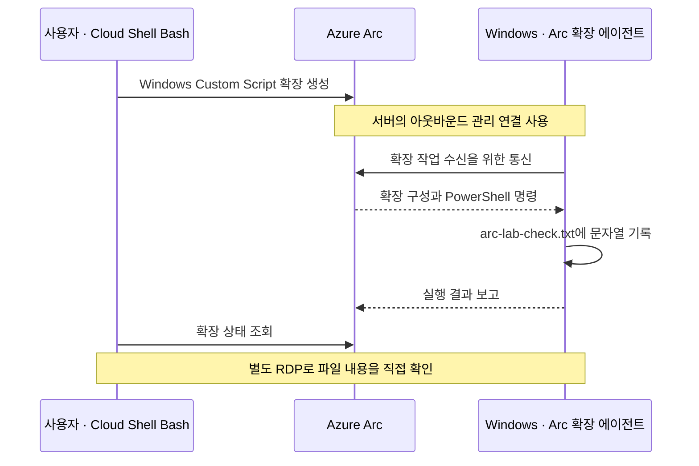

# 04–07. Azure Arc 등록·관리·정리 실습

> 목표 시간 50분. README에서 만든 같은 Windows Server VM을 계속 사용하여 평가 환경을 준비하고,
> Arc 연결과 실제 확장 실행을 검증한 다음 정리합니다. 재부팅·배포 대기에 따라 더 걸릴 수 있습니다.

[시작 가이드](../README.md)의 전용 **Windows Server 2022 Datacenter x64 GUI VM**과
RDP 접속 확인을 마친 뒤 진행합니다. VM·컴퓨터·Arc 서버 이름은 `arc-lab-win-01`을 사용합니다.

⚠️ **주의**

**운영 VM에서는 실행하지 마세요.** Azure VM 확장과 Guest Agent를 비활성화하는
평가 전용 구성입니다. Guest Agent를 끈 뒤에는 VM Run Command나 Portal의 암호 재설정으로
복구할 수 있다고 가정하면 안 됩니다. 로컬 관리자 암호와 RDP 관리 경로를 먼저 확보합니다.

## 목표와 진행 순서

| 모듈 | 할 일 | 완료 기준 | 목표 시간 |
| --- | --- | --- | ---: |
| 04 | [평가 환경 준비](#prepare): 1–3절 | RDP 유지, Guest Agent 비활성, IMDS 차단, 평가 변수 확인 | 15분 |
| 05 | [Arc 등록·기본 관리](#onboard): 4–5절 | `Connected`, 올바른 리소스 ID, 태그 저장 | 10분 |
| 06 | [확장 실습](#extension-lab): 6절 | 확장 `Succeeded`, 실제 파일 내용 확인, 확장 제거 | 15분 |
| 07 | [정리·운영 차이](#cleanup): 7절 이후 | Arc 서버와 전용 실습 자원 삭제, 운영 차이 이해 | 10분 |

앞 모듈을 건너뛰어 확장부터 설치하지 않습니다.
전체 흐름이나 용어가 낯설면 [00. Azure Arc 첫걸음](00-azure-arc-basics.md)을 먼저 읽습니다.

## 실행 위치와 읽는 방법

각 작업의 **👁️ 설명 → 🟢 실행 → 📋 확인**을 한 묶음으로 읽습니다.
앞 단계에서 성공했다는 사실과 현재 단계의 성공을 구분하며 실제 결과를 비교합니다.

| 표시 | 실행 위치 |
| --- | --- |
| PC / PowerShell | 내 Windows PC. 원격 데스크톱 연결 시작 |
| Windows VM / 관리자 Windows PowerShell | RDP로 접속한 VM의 **64비트 Windows PowerShell 5.1**, 관리자 권한으로 실행 |
| Cloud Shell / Bash | Azure Portal 우측 상단 Cloud Shell. **Bash** 선택 |
| Portal | Azure Portal 화면 |

**명령이 실패하면 해당 단계에서 멈춥니다.** 여러 절을 한꺼번에 붙여 넣지 마세요.
아래 PowerShell 블록의 `$ErrorActionPreference = 'Stop'`은 cmdlet 오류에서 중단하도록 합니다.
외부 실행 파일의 실패는 `$LASTEXITCODE`로 별도 확인합니다.
실습에 사용할 구독·리전·IP를 직접 확인하며 꺾쇠 부분을 실제 값으로 바꿉니다.

핵심 합격 기준은 Arc `Connected`, 확장 `Succeeded`, VM 안 파일의 `arc-lab-ok`입니다.
현재 문서는 공식 문서 기반이며 **실제 Azure 환경에서 끝까지 실행 검증하지 않았습니다.**

<a id="prepare"></a>
## 1. 실습 전 상태 확인

👁️ **설명**

모듈 04에서는 Azure VM의 관리 방식을 평가용으로 바꿉니다.
다른 실습에서 남은 에이전트나 방화벽 규칙을 새 등록과 혼동하지 않도록,
같은 전용 VM인지, 아직 Arc를 설치하지 않았는지 먼저 확인합니다.

🟢 **실행 — Windows VM / 관리자 Windows PowerShell**

```powershell
$ErrorActionPreference = 'Stop'
$env:COMPUTERNAME
Test-Path "$env:ProgramFiles\AzureConnectedMachineAgent\azcmagent.exe"
Get-NetFirewallProfile -PolicyStore ActiveStore | Select-Object Name, Enabled, DefaultInboundAction, DefaultOutboundAction
```

📋 **확인**

컴퓨터 이름은 `ARC-LAB-WIN-01`이어야 합니다. 대소문자는 구분하지 않습니다.
Arc 에이전트 경로는 새 VM에서 `False`여야 합니다.
이미 설치되어 있다면 덮어쓰지 말고 기존 등록과 소유자를 확인합니다.
Windows 방화벽은 활성 상태여야 하며 조직 정책이 아웃바운드를 막으면 관리자에게 확인합니다.
**방화벽·보안 제품을 통째로 끄지 않습니다.**

🟢 **실행 — Portal**

**Azure Arc → 인프라 → 머신**에서 같은 구독·그룹·이름으로 등록된 서버가 없는지 확인합니다.
새 실습이라면 없는 것이 정상입니다. 이미 있다면 임의 삭제하지 않습니다.

## 2. Azure VM 확장 제거와 Guest Agent 비활성화

👁️ **설명**

Azure Windows VM Guest Agent(`WindowsAzureGuestAgent`)는 VM 관리 기능이 OS 안에서
작업하도록 돕습니다. Arc는 별도 Connected Machine Agent를 사용합니다.
**Azure VM 확장 제거를 마친 뒤 Guest Agent를 중지**하여 두 관리 경로가 충돌하지 않게 합니다.
Guest Agent가 동작할 때 확장을 먼저 제거해야 제거 작업을 처리할 수 있습니다.

🟢 **실행 — Portal / Azure VM 리소스**

Azure VM `arc-lab-win-01`의 **설정 → 확장 + 애플리케이션**에서 Azure Monitor,
Guest Attestation, Network Watcher 등 설치된 VM 확장을 모두 제거하고 완료까지 기다립니다.
정책이 다시 설치하거나 제거가 거부된다면 중단하고 관리자에게 문의합니다.

📋 **확인**

Azure VM의 확장 목록이 비어 있고 진행 중인 제거 작업이 없어야 합니다.
Arc 서버의 확장 목록을 확인하는 단계가 아닙니다.

🟢 **실행 — Windows VM / 관리자 Windows PowerShell**

```powershell
$ErrorActionPreference = 'Stop'
Set-Service -Name WindowsAzureGuestAgent -StartupType Disabled
Stop-Service -Name WindowsAzureGuestAgent -Force
Get-Service -Name WindowsAzureGuestAgent | Select-Object Name, Status, StartType
```

📋 **확인**

`Status=Stopped`, `StartType=Disabled`여야 합니다.
서비스가 없거나 권한 오류가 나면 같은 결과로 간주하지 마세요.
`Stop-Service`는 현재 중지, `Set-Service`는 다음 부팅의 시작 동작을 설정합니다.
앞으로 확장 실습은 **Azure VM 리소스가 아닌 Arc 서버 리소스**에서 수행합니다.
이 변경이 VM 자체의 삭제나 전원 제어를 막지는 않습니다.

<a id="evaluation-settings"></a>
## 3. 평가 환경 변수와 방화벽 준비

### 3-1. Machine 범위와 현재 프로세스에 평가 변수 설정

👁️ **설명**

`MSFT_ARC_TEST`는 Azure VM에서 평가 절차를 수행함을 알리는 환경 변수입니다.
공식 Windows 절차처럼 **Machine 범위**에 저장하고, 이미 열린 PowerShell에도 별도 설정합니다.
Machine 범위 저장과 기존 프로세스의 환경은 다릅니다.

🟢 **실행 — Windows VM / 관리자 Windows PowerShell**

```powershell
$ErrorActionPreference = 'Stop'
[Environment]::SetEnvironmentVariable('MSFT_ARC_TEST', 'true', 'Machine')
$env:MSFT_ARC_TEST = 'true'
[Environment]::GetEnvironmentVariable('MSFT_ARC_TEST', 'Machine')
$env:MSFT_ARC_TEST
```

📋 **확인**

두 값 모두 `true`여야 합니다. Machine 설정은 재부팅 후에도 남지만,
기존 서비스나 다른 PowerShell 창이 즉시 새 값을 상속한다고 가정하지 않습니다.
3-4절에서 **에이전트 설치 전 재부팅**하여 새 환경을 적용합니다.

### 3-2. RDP와 인터넷 통신을 유지하면서 IMDS만 차단

👁️ **설명**

IMDS는 Azure VM의 메타데이터와 관리 ID를 제공하는 서비스입니다.
평가 절차에서는 두 IMDS 주소를 차단하여 Arc의 관리 표현과 혼동하지 않도록 합니다.
NSG와 달리 다음 규칙은 **Windows OS 방화벽의 아웃바운드 규칙**입니다.
RDP 인바운드 허용 규칙이나 방화벽의 기본 동작을 전체 변경하지 않습니다.
PC 공인 IP `/32` 제한은 README에서 구성한 NSG에 유지합니다.

🟢 **실행 — Windows VM / 관리자 Windows PowerShell**

```powershell
$ErrorActionPreference = 'Stop'
New-NetFirewallRule -Name 'BlockAzureIMDS' -DisplayName 'Block Azure IMDS for Arc evaluation' -Enabled True -Profile Any -Direction Outbound -Action Block -RemoteAddress '169.254.169.254','169.254.169.253'
Get-NetFirewallRule -PolicyStore ActiveStore -Name 'BlockAzureIMDS' | Format-List Name, Enabled, Direction, Action, Profile
Get-NetFirewallRule -PolicyStore ActiveStore -Name 'BlockAzureIMDS' | Get-NetFirewallAddressFilter | Select-Object RemoteAddress
```

📋 **확인**

규칙이 `Enabled=True`, `Direction=Outbound`, `Action=Block`, `Profile=Any`이고
`RemoteAddress`에 **두 주소 모두** 있어야 합니다.
규칙이 이미 있으면 중복 생성하지 말고 현재 구성과 이번 실습 소유 여부부터 확인합니다.
정책이 로컬 규칙을 무시하면 관리자에게 확인하고 다음 단계로 넘어가지 않습니다.
차단 후 Azure VM의 관리 ID 인증도 사용할 수 없으므로 이번 온보딩은 사용자 인증을 사용합니다.

⚠️ **주의**

변경 후 PC에서 새 RDP 연결로 다시 접속해 관리 경로를 확인합니다.
같은 계정이면 기존 세션에 다시 연결될 수 있으며 독립 세션 두 개를 보장하지는 않습니다.
암호를 모르는 상태로 로그오프하지 마세요. 접속 실패를 해결하려고 RDP를 전체 인터넷에 열거나
Windows 방화벽·NLA를 해제하지 않습니다.

### 3-3. IMDS 차단과 외부 HTTPS를 따로 검증

👁️ **설명**

“IMDS에 연결할 수 없다”와 “인터넷 통신이 모두 끊겼다”는 다릅니다.
`curl`이라는 PowerShell 별칭 대신 **`curl.exe`**를 명시하여 프록시 없이 두 주소를 검사합니다.

🟢 **실행 — Windows VM / 관리자 Windows PowerShell**

```powershell
$ErrorActionPreference = 'Stop'
foreach ($address in '169.254.169.254', '169.254.169.253') {
    & curl.exe --noproxy '*' --connect-timeout 2 --max-time 3 -sS -o NUL "http://$address/metadata/instance?api-version=2021-02-01" -H 'Metadata: true'
    $code = $LASTEXITCODE
    if ($code -eq 0) {
        throw "FAIL: IMDS is reachable: $address"
    }
    if ($code -notin 7, 28) {
        throw "FAIL: unexpected curl error $code for $address"
    }
    "BLOCKED: $address (curl exit $code)"
}
```

📋 **확인**

**두 주소 모두 `BLOCKED`이며 앞 절의 실제 차단 규칙도 확인**되어야 합니다.
HTTP 400/404 응답도 차단 성공이 아닙니다.
타임아웃만으로 방화벽 적용을 입증할 수 없으므로 규칙과 함께 판단합니다.

🟢 **실행 — Windows VM / 관리자 Windows PowerShell**

```powershell
$ErrorActionPreference = 'Stop'
Resolve-DnsName aka.ms
& curl.exe -I -L --connect-timeout 5 --max-time 30 https://aka.ms/AzureConnectedMachineAgent
if ($LASTEXITCODE -ne 0) { throw 'Agent download endpoint HTTPS check failed' }
```

📋 **확인**

DNS 해석, 리디렉션 대상까지의 정상 HTTPS 응답이 필요합니다.
`curl.exe`는 HTTP 오류에도 종료 코드 0일 수 있으므로 **응답 상태도 직접 확인**합니다.
이것만으로 모든 Arc 엔드포인트를 검증한 것은 아니며 설치 후 연결 검사도 수행합니다.

### 3-4. 설치 전 재부팅과 재검증

👁️ **설명**

Machine 환경 변수를 서비스까지 확실히 적용하기 위해 이 시점에 한 번 재부팅합니다.
작업 중인 파일을 저장하세요. 다음 명령은 RDP를 끊으며, VM이 다시 부팅된 후 같은 IP로 재접속합니다.

🟢 **실행 — Windows VM / 관리자 Windows PowerShell**

```powershell
Restart-Computer
```

재접속 후 **관리자 64비트 Windows PowerShell**을 새로 열어 실행합니다.

```powershell
$ErrorActionPreference = 'Stop'
Get-Service -Name WindowsAzureGuestAgent | Select-Object Name, Status, StartType
[Environment]::GetEnvironmentVariable('MSFT_ARC_TEST', 'Machine')
$env:MSFT_ARC_TEST
Get-NetFirewallProfile -PolicyStore ActiveStore | Select-Object Name, Enabled
Get-NetFirewallRule -PolicyStore ActiveStore -Name 'BlockAzureIMDS' | Format-List Name, Enabled, Direction, Action, Profile
Get-NetFirewallRule -PolicyStore ActiveStore -Name 'BlockAzureIMDS' | Get-NetFirewallAddressFilter | Select-Object RemoteAddress
```

📋 **확인**

Guest Agent가 여전히 `Stopped`·`Disabled`, Machine·현재 프로세스의 변수가 모두 `true`,
방화벽이 활성 상태이고 IMDS 두 주소의 차단 규칙이 유지되어야 합니다.
**3-3절의 IMDS·외부 HTTPS 검사도 다시 실행**합니다.
값이 다르거나 정책이 설정을 되돌리면 중단하고 원인을 확인합니다.
관리 경로를 잃었다면 Run Command 복구에 의존하지 말고 실습 VM을 새로 준비하는 편이 단순합니다.
기존 실패 리소스의 정리도 빠뜨리지 마세요.

### 모듈 04 완료 체크

- [ ] Azure VM 확장이 없고 `WindowsAzureGuestAgent`가 `Stopped`·`Disabled`입니다.
- [ ] 재부팅 후 Machine과 현재 PowerShell의 평가 변수가 `true`입니다.
- [ ] RDP로 재접속했고 IMDS 두 주소의 방화벽 규칙과 차단 결과를 확인했습니다.
- [ ] Microsoft 다운로드 주소의 DNS·HTTPS는 계속 동작합니다.

<a id="onboard"></a>
## 4. Portal에서 Windows 온보딩 스크립트 생성

👁️ **설명**

모듈 05에서는 준비한 Windows Server를 Arc의 관리 대상으로 등록합니다.
Portal 스크립트는 에이전트를 설치하고 선택한 구독·그룹·리전에 연결합니다.
**VM의 관리자 권한**은 OS 설치 권한이고 **Microsoft 로그인**은 Azure 등록 권한입니다.

🟢 **실행 — Portal**

1. **Azure Arc → 인프라 → 머신 → 온보딩/만들기 → 기존 머신 온보딩**을 선택합니다.
2. VM을 만든 구독, `rg-arc-lab-01`, **Windows**를 선택합니다.
3. 메타데이터를 보관할 **Arc 지원 리전**을 기록합니다.
   VM·리소스 그룹 리전과 다를 수 있으며 이후 확장 명령에는 Arc 리전을 사용합니다.
4. **공용 엔드포인트**, **머신 수동 인증**을 선택합니다.
   Private Link, Arc Gateway, 프록시는 새로 구성하지 않습니다.
5. 모니터링·보안·업데이트 등 유료 기능 옵션을 검토하고 이번 실습에서 새로 켜지 않습니다.
   정책상 강제 활성화라면 중단합니다.
6. `OnboardingScript.ps1`을 저장소 밖에 내려받습니다.
   실행 전 텍스트 편집기로 구독·그룹·리전·설치 주소·인증 방식을 확인합니다.

📋 **확인**

대상이 Windows이며 구독·그룹·Arc 리전이 실습의 선택값과 같아야 합니다.
VM Guest Agent가 아니라 Arc Connected Machine Agent를 설치하는 스크립트인지 확인합니다.

🟢 **실행 — Windows VM / RDP**

검토한 스크립트를 **VM의 사용자 Downloads 폴더**로 옮깁니다.
승인된 RDP 파일 복사 기능을 사용하거나 VM 안 브라우저에서 직접 Portal에 로그인하여 생성·다운로드합니다.
조직이 클립보드·드라이브 공유를 막으면 우회하지 말고 승인된 전송 경로를 요청합니다.
PC의 파일 경로와 VM의 파일 경로는 다릅니다. 확장자가 `.ps1.txt`가 아닌지 확인하세요.
스크립트·토큰·계정 암호를 Git에 넣지 않습니다.

🟢 **실행 — Windows VM / 관리자 Windows PowerShell**

```powershell
$ErrorActionPreference = 'Stop'
Set-Location "$env:USERPROFILE\Downloads"
Get-Item .\OnboardingScript.ps1
$env:MSFT_ARC_TEST
Get-ExecutionPolicy -List
```

📋 **확인**

실제 검토한 파일이며 평가 변수는 `true`여야 합니다.
실행 정책이 스크립트를 차단하면 조직의 허용 절차를 확인합니다.
인터넷 다운로드 표시로만 차단되고 파일 출처·내용을 검토했다면 다음 `Unblock-File`을 적용합니다.
서명 강제나 Group Policy를 `Bypass`·`Unrestricted`로 우회하지 않습니다.

🟢 **실행 — Windows VM / 관리자 Windows PowerShell**

```powershell
$ErrorActionPreference = 'Stop'
Unblock-File -LiteralPath .\OnboardingScript.ps1
.\OnboardingScript.ps1
```

⚠️ **주의**

스크립트가 연 Microsoft 로그인 창 또는 직접 표시한 Microsoft 인증 주소·코드만 사용합니다.
계정·테넌트·구독이 맞는지 확인하세요. 조건부 액세스가 인증을 막으면 보안 정책을 우회하지 않습니다.
새 서비스 주체·클라이언트 비밀을 만들어 우회하는 단계는 이 실습에 없습니다.

📋 **확인**

설치와 연결 성공 메시지를 확인합니다. 실패하면 다음 절에서 상태를 확인하되 등록 성공으로
처리하지 않습니다. 재실행 전 기존 Arc 리소스가 생성됐는지 확인합니다.

## 5. 연결 확인과 기본 관리

### 5-1. 에이전트와 Portal의 같은 서버 확인

👁️ **설명**

설치 직후 PATH가 현재 창에 갱신되지 않을 수 있어 `azcmagent.exe`의 전체 경로를 사용합니다.
같은 이름이 다른 구독에도 있을 수 있으므로 **리소스 ID까지 비교**합니다.
`Connected`는 관리 연결 상태이지 애플리케이션이나 모든 확장의 성공을 의미하지 않습니다.

🟢 **실행 — Windows VM / 관리자 Windows PowerShell**

```powershell
& "$env:ProgramFiles\AzureConnectedMachineAgent\azcmagent.exe" show
if ($LASTEXITCODE -ne 0) { throw 'azcmagent show failed' }
```

📋 **확인**

Portal에서도 Azure VM이 아닌 **Azure Arc의 머신**을 열고 비교합니다.
Windows가 컴퓨터 이름을 대문자로 표시하면 그 대소문자 차이는 정상입니다.

| 확인값 | 기대하는 내용 |
| --- | --- |
| 상태 | 에이전트와 Portal 모두 `Connected` |
| 리소스 이름 | `arc-lab-win-01` (대소문자 차이 허용) |
| 리소스 ID | 선택한 구독·`rg-arc-lab-01`·`Microsoft.HybridCompute/machines` 경로 |
| OS·에이전트 | Windows Server 2022 정보와 설치된 에이전트 버전 |

🟢 **실행 — Windows VM / 관리자 Windows PowerShell / 연결 오류가 있을 때만**

실제 Arc 리전으로 검사하고 로컬 로그를 확인합니다.

```powershell
& "$env:ProgramFiles\AzureConnectedMachineAgent\azcmagent.exe" check --location '<ARC_REGION>'
if ($LASTEXITCODE -ne 0) { Write-Error 'Arc endpoint check failed; inspect the diagnostic output and local log' }
Get-Content "$env:ProgramData\AzureConnectedMachineAgent\Log\azcmagent.log" -Tail 80
```

단일 사이트 HTTPS 성공과 달리 이 검사는 Arc 엔드포인트를 확인합니다.
오류는 방화벽·프록시·DNS, 대상 리전, 테넌트·권한으로 나누어 확인하세요.
로그는 로컬에서 검토하고 식별자·인증 정보가 담긴 원문을 그대로 공유하지 마세요.
`$ErrorActionPreference='Stop'` 때문에 오류에서 멈췄다면 로그 조회 행을 별도로 실행합니다.

### 5-2. 태그를 저장하고 다시 조회

👁️ **설명**

태그는 리소스에 붙이는 이름·값의 표식입니다.
`lab=arc-test-01`로 실습 대상을 분류합니다. 이는 Azure 관리 정보 변경이며
Windows 안에서 명령을 실행하는 단계는 아닙니다.

🟢 **실행 — Portal / Arc 서버 리소스**

**Arc 머신 → 태그**에서 `lab=arc-test-01`을 추가하고 저장합니다.

📋 **확인**

페이지를 다시 열어 태그가 유지되는지 확인합니다.

### 모듈 05 완료 체크

- [ ] Portal의 Azure VM과 Arc 머신을 구분하여 열었습니다.
- [ ] `Connected`, 리소스 ID, Windows OS·에이전트 버전을 확인했습니다.
- [ ] Arc 서버의 `lab=arc-test-01` 태그가 다시 열어도 유지됩니다.

<a id="extension-lab"></a>
## 6. Arc 확장으로 Windows 파일 생성

### 6-1. 실행 경로 이해

👁️ **설명**

모듈 06에서는 **Windows 안에서 실제 변경**을 수행합니다.
Custom Script 확장은 Arc 확장 경로로 명령을 전달하고 OS에서 실행합니다.
꺼 둔 Guest Agent를 켜거나 `az vm extension create`로 대체하지 않습니다.



Windows Custom Script의 publisher는 **`Microsoft.Compute`**, type은
**`CustomScriptExtension`**, 공식 handler 예시는 **`1.10`**입니다.
Linux용 확장과 이름·버전이 다릅니다. Arc의 지원 목록과 Windows Server 2022 지원을 함께 확인합니다.
기본 Custom Script 관리는 [Arc 기본 제어 영역 요금][pricing]에서 무료로 안내되지만,
VM·Windows 라이선스·디스크 등 기반 자원 요금은 계속됩니다.

다음 관리 명령은 **Cloud Shell / Bash**에서 실행합니다.
가능하면 저장소를 연결하지 않는 임시 세션으로 열어 별도 스토리지를 만들지 않습니다.
**VM의 Windows PowerShell에 Bash 명령을 붙여 넣지 마세요.**

<a id="cloud-shell-setup"></a>
### 6-2. Cloud Shell 공통 준비와 세션 복구

🟢 **실행 — Cloud Shell / Bash**

```bash
SUBSCRIPTION_ID='<YOUR_SUBSCRIPTION_ID>'
RG='rg-arc-lab-01'
MACHINE='arc-lab-win-01'
ARC_REGION='<YOUR_ARC_REGION>'
az account set --subscription "$SUBSCRIPTION_ID"
```

📋 **확인**

`az account set`이 오류 없이 끝나야 합니다.
새 세션에는 변수가 남지 않습니다. 끊겼다면 같은 구독·그룹·머신·Arc 리전으로 다시 준비하고,
기존 확장을 생성 명령으로 덮어쓰지 말고 조회부터 수행합니다.

🟢 **실행 — Cloud Shell / Bash**

현재 CLI 참조 문서의 최소 버전은 **2.75.0**입니다.
VM의 `azcmagent.exe`와 Cloud Shell의 `az connectedmachine`은 다른 도구입니다.

```bash
az version
az account show --query '{subscription:id,tenant:tenantId}' -o json
az extension add --name connectedmachine --upgrade
az connectedmachine show --resource-group "$RG" --name "$MACHINE" \
  --query '{id:id,location:location,status:status}' -o json
```

📋 **확인**

출력의 구독·머신이 맞고 `location`이 `$ARC_REGION`과 같아야 합니다.
이름이 대문자로 표시되어도 전체 리소스 ID를 비교합니다. 다른 대상이면 여기서 멈춥니다.

### 6-3. 지역별 Windows 확장 이미지 확인

👁️ **설명**

publisher는 배포자, type은 확장 종류, handler version은 설치할 처리기의 버전입니다.
Windows OS 지원과 Arc 리전별 제공 여부는 서로 다른 조건입니다.

🟢 **실행 — Cloud Shell / Bash**

```bash
az connectedmachine extension image list \
  --location "$ARC_REGION" \
  --publisher Microsoft.Compute \
  --extension-type CustomScriptExtension -o json
```

📋 **확인**

공식 예시인 `1.10` 계열이 제공되는지 확인합니다.
목록이 비거나 해당 계열을 확인할 수 없으면 임의 버전을 추측하지 말고 지원 리전·확장을 확인합니다.

### 6-4. 실제 변경과 결과 확인

👁️ **설명**

명령은 VM의 `C:\ProgramData\ArcLab\arc-lab-check.txt`에 `arc-lab-ok` 한 줄을 기록합니다.
사용자 Downloads가 아니라 시스템 경로를 쓰는 이유는 확장이 **LocalSystem**으로 실행되기 때문입니다.
`Succeeded`는 Azure 쪽 결과이고, 파일 내용은 게스트 OS 쪽 결과입니다. 둘 다 확인합니다.

⚠️ **주의**

다음은 **Arc 확장을 생성하여 LocalSystem 권한으로 디렉터리·파일을 기록하는 변경 작업**입니다.
대상 머신을 다시 확인하세요. 공개 settings에 비밀을 넣지 않습니다.

🟢 **실행 — Cloud Shell / Bash**

아래 작은따옴표 전체를 그대로 사용합니다. Bash → JSON → Windows PowerShell 순서로 해석됩니다.
JSON 경로의 `\\`는 실제 Windows 경로에서 `\` 한 개가 됩니다.
명령 안의 `$ErrorActionPreference`는 Bash 변수가 아니라 VM에서 실행할 PowerShell 코드입니다.

```bash
az connectedmachine extension create \
  --resource-group "$RG" --machine-name "$MACHINE" \
  --name arc-lab-custom-script --location "$ARC_REGION" \
  --publisher Microsoft.Compute --type CustomScriptExtension \
  --type-handler-version 1.10 --auto-upgrade-minor-version true \
  --settings '{"commandToExecute":"powershell.exe -NoProfile -NonInteractive -Command \"$ErrorActionPreference = '\''Stop'\''; New-Item -ItemType Directory -Path C:\\ProgramData\\ArcLab -Force | Out-Null; Set-Content -LiteralPath C:\\ProgramData\\ArcLab\\arc-lab-check.txt -Value arc-lab-ok -Encoding ascii\""}'
```

`commandToExecute`는 로컬 파일 기록뿐이며 외부 스크립트를 다운로드하지 않습니다.
실행 정책을 우회하는 옵션이나 관리 ID 기반 다운로드는 사용하지 않습니다.
완료 후 상태를 조회합니다.

🟢 **실행 — Cloud Shell / Bash**

```bash
az connectedmachine extension show \
  --resource-group "$RG" --machine-name "$MACHINE" \
  --name arc-lab-custom-script -o json
```

📋 **확인 — Azure 쪽 결과**

`provisioningState=Succeeded`여야 합니다. 진행 중이면 완료 후 다시 조회하고,
`Failed`라면 instance view의 오류와 Windows 확장 로그를 확인합니다.

🟢 **실행 — Windows VM / 관리자 Windows PowerShell**

RDP로 접속한 **같은 VM**에서 파일 내용을 확인합니다.

```powershell
$ErrorActionPreference = 'Stop'
Get-Content -LiteralPath 'C:\ProgramData\ArcLab\arc-lab-check.txt'
```

📋 **확인 — OS 쪽 결과**

`arc-lab-ok`가 출력되어야 합니다.
파일이 없으면 VM에서 직접 만들어 성공한 것처럼 처리하지 마세요.

### 6-5. 확장 제거와 산출물 수명

👁️ **설명**

확장 설치·제거와 명령이 만든 파일의 수명은 다릅니다.
확장 제거가 자동 롤백을 의미하지 않음을 확인합니다.

🟢 **실행 — Cloud Shell / Bash**

```bash
az connectedmachine extension delete \
  --resource-group "$RG" --machine-name "$MACHINE" \
  --name arc-lab-custom-script
```

삭제 확인을 요청하면 대상을 확인하고 승인합니다. 성공한 뒤 목록을 조회합니다.

```bash
az connectedmachine extension list \
  --resource-group "$RG" --machine-name "$MACHINE" -o json
```

📋 **확인**

목록에서 `arc-lab-custom-script`가 없어야 합니다.
**확장 제거가 실행 결과까지 되돌리지는 않습니다.** 파일은 남을 수 있으며 VM 삭제 시 함께 제거됩니다.
다른 확장이 남아 있다면 정책에 의한 설치인지 확인하고 정리 전에 원인을 파악합니다.

### 모듈 06 완료 체크

- [ ] 구독·그룹·머신·Arc 리전이 실습 대상과 일치했습니다.
- [ ] Windows용 publisher·type·handler의 리전별 제공 여부를 확인했습니다.
- [ ] Arc 확장 `Succeeded`와 RDP에서 확인한 `arc-lab-ok` 출력을 모두 확인했습니다.
- [ ] 확장 제거 후 목록에서 사라졌으며 파일은 별도로 남을 수 있음을 이해했습니다.

<a id="cleanup"></a>
## 7. 연결 해제와 리소스 정리

👁️ **설명**

모듈 07에서는 **확장 제거 → Arc 연결 해제 → 전용 그룹 삭제 → 잔존 자원 확인** 순서로 정리합니다.
컴퓨터를 끄는 것, Arc 등록을 지우는 것, 과금 자원을 지우는 것은 같은 작업이 아닙니다.

⚠️ **주의**

실패해도 생성된 리소스는 자동 삭제되지 않습니다.
**이번에 만든 전용 실습 리소스만** 대상으로 합니다. 공유 그룹·다른 사람의 VM은 삭제하지 마세요.

🟢 **실행 — Windows VM / 관리자 Windows PowerShell과 Portal**

1. 설치된 Arc 확장을 먼저 제거합니다. 6절에서 제거했다면 목록으로 확인합니다.
2. **Windows VM / 관리자 Windows PowerShell**에서 실행합니다.

   ```powershell
   & "$env:ProgramFiles\AzureConnectedMachineAgent\azcmagent.exe" disconnect
   if ($LASTEXITCODE -ne 0) { throw 'Arc disconnect failed; do not assume the cloud resource was deleted' }
   & "$env:ProgramFiles\AzureConnectedMachineAgent\azcmagent.exe" show
   if ($LASTEXITCODE -ne 0) { throw 'azcmagent show failed; inspect the local registration state' }
   ```

   같은 테넌트의 계정으로 로그인하고 연결 해제 성공을 확인합니다.
   `disconnect`는 클라우드 Arc 서버 리소스를 삭제하고 로컬 등록을 초기화합니다.
   에이전트 프로그램 자체를 제거하는 명령은 아닙니다.
   VM을 바로 삭제하므로 별도 MSI 제거·평가 설정 복원은 생략합니다.
   이 VM을 그대로 운영에 재사용하는 절차가 아닙니다.
3. **Portal → Azure Arc → 머신**에서 같은 구독·그룹의 Arc 서버가 사라졌는지 확인합니다.
   오류·권한 부족이면 해제됐다고 가정하지 말고 관리자에게 요청합니다.
   `--force-local-only`는 클라우드 리소스를 삭제하지 않으므로 일반 정리 대안으로 쓰지 않습니다.
4. **Portal → 리소스 그룹 → `rg-arc-lab-01`**에서 자원·구독·소유권을 확인합니다.
   이번 실습 자원만 있고 보존할 데이터가 없다면 **리소스 그룹 삭제**를 선택하고 그룹 이름으로 승인합니다.
5. 삭제 완료 후 `arc-lab-win-01`과 실습 그룹을 검색하여
   **Arc 서버, VM, OS 디스크, NIC, NSG, VNet, 공인 IP**가 남지 않았는지 확인합니다.
   Arc를 다른 그룹에 잘못 등록했다면 그 리소스도 소유권을 확인하여 별도 정리합니다.

📋 **확인**

| 정리 대상 | 확인 기준 |
| --- | --- |
| Arc 확장 | 삭제 성공, 머신의 확장 목록에서 사라짐 |
| Arc 서버 | 같은 구독·그룹의 Arc 머신 목록에서 사라짐 |
| 전용 실습 그룹 | 삭제 완료 |
| VM·OS 디스크·NIC·NSG·VNet·공인 IP | 이번 실습의 자원이 남아 있지 않음 |
| 별도 Cloud Shell 스토리지 | 만들었다면 공유 여부 확인 후 따로 처리 |

등록 전 실패했다면 `disconnect`가 필요 없거나 실행할 수 없을 수 있습니다.
클라우드 Arc 리소스 생성 여부부터 확인하고, 생성됐다면 관리자와 삭제한 뒤 전용 그룹을 정리합니다.
Windows 종료·Portal 할당 해제만으로 정리를 끝내지 마세요. 디스크·공인 IP 요금은 남을 수 있습니다.
Cost Management 반영은 지연될 수 있으며 삭제 직후 사용 요금이 0이 아니라고 삭제 실패는 아닙니다.

<a id="existing-linux-lab"></a>
### 이전 Ubuntu 실습을 이미 시작했다면

👁️ **설명**

이번 변경은 **교재의 대상 OS 변경**이지 기존 VM의 OS 변환이나 자동 삭제가 아닙니다.
Linux OS 디스크를 Windows로 바꾸거나 기존 Arc 등록을 Windows 서버용으로 덮어쓰지 않습니다.

🟢 **실행 — Portal / 기존 Ubuntu VM의 SSH**

이전 실습의 Arc 확장을 제거한 뒤, 기존 Ubuntu VM에 SSH로 접속하여 `sudo azcmagent disconnect`를
실행하고 종료 코드 0과 연결 해제 성공을 확인합니다.
이는 **이전 Linux VM 정리 전용 명령**이며 새 Windows VM에서 실행하지 않습니다.
아직 등록하지 않았다면 클라우드 Arc 리소스 생성 여부만 확인합니다.
VM에 접근할 수 없으면 소유권을 확인한 후 관리자에게 Arc 리소스 삭제를 요청합니다.

Portal에서 이전 `arc-lab-ubuntu-01` Arc 서버가 사라졌는지 확인하고,
전용 실습 그룹에 보존할 자원이 없는지 검토한 뒤 기존 그룹을 삭제합니다.
VM·디스크·네트워크·공인 IP 잔존 여부까지 확인한 다음 README에서 새 Windows VM을 만듭니다.
새 VM을 이미 같은 그룹에 만들었다면 **그룹 전체 삭제를 하지 말고** 기존 자원만 구분하여 정리합니다.

<a id="production-differences"></a>
### 운영 환경으로 확장할 때 달라지는 점

👁️ **설명**

실습에 성공했다고 운영 환경의 보안·가용성·비용 관리가 완성되는 것은 아닙니다.

| 구분 | 이번 실습 | 운영 적용 시 검토 |
| --- | --- | --- |
| 서버 위치 | Azure Windows VM을 외부 서버처럼 준비 | 실제 온프레미스·다른 클라우드의 지원 OS |
| 평가 우회 설정 | Guest Agent 비활성화, IMDS 차단, Machine 평가 변수 | Azure VM 전용 테스트 절차를 외부 서버에 그대로 적용하지 않기 |
| 접근 경로 | 실습자 IP 제한 공인 RDP·로컬 계정 | 관리망·Bastion 등 접속 통제, 자격 증명·감사 요구사항에 맞게 설계 |
| Arc 통신 | 공용 엔드포인트 아웃바운드 | 방화벽·프록시·Private Link·Arc Gateway 필요성 평가 |
| 권한과 인증 | 사용자 수동 등록과 전용 그룹 | 최소 권한, 온보딩 방식, 자격 증명 수명 관리 |
| 상태 검증 | 연결·태그·파일 생성 한 번 확인 | 모니터링·에이전트 업데이트·장애 대응·복구 절차 |
| 부가 관리 | 유료 관리 서비스를 새로 켜지 않음 | Policy·Monitor·Defender·Update Manager의 필요성·요금·정책 |
| 자원 수명 | 실습 후 전용 그룹 삭제 | 등록 해제·폐기 절차, 데이터 보존, 운영 변경 승인 |

이 표는 운영 설계 검토의 출발점이지 운영 적합성 인증이나 구축 자동화 도구가 아닙니다.

<a id="troubleshooting"></a>
## 8. 문제가 생겼을 때

👁️ **설명**

로그인 실패를 네트워크 전체 개방으로 해결하거나, 파일을 직접 만들어 확장 성공으로 처리하지 않습니다.
이미 생성한 자원이 있다면 쓰기 명령을 반복하기 전에 읽기 전용 상태 조회부터 수행합니다.

| 증상 | 확인할 내용 |
| --- | --- |
| Azure VM에는 지원되지 않는다는 설치 오류 | Windows Machine·현재 프로세스 평가 변수, 재부팅 후 상태, IMDS 두 주소 차단, VM 확장·Guest Agent 제거 순서 |
| RDP 시간 초과 | VM 전원·공인 IP, 실제 PC 출구 IP와 NSG `/32`, Windows 방화벽의 기존 RDP 허용, 회사 TCP 3389 차단 |
| RDP 로그인 실패 | `arc-lab-win-01\arcadmin` 계정·암호·NLA·시스템 시간. Guest Agent 중지 후 VMAccess 암호 재설정에 의존하지 않기 |
| PowerShell 스크립트 차단 | 64비트 관리자 Windows PowerShell, 검토한 파일의 다운로드 표시, 실행 정책·서명·조직 GPO |
| Arc `Disconnected` | `azcmagent.exe check`, DNS·필수 HTTPS, 프록시, 리전, 시스템 시간, `himds` 서비스 |
| 로그인·권한 오류 | 같은 테넌트·구독인지, 온보딩 역할과 확장·삭제 권한의 차이, 조건부 액세스 |
| 확장 배포 실패 | Windows용 `Microsoft.Compute/CustomScriptExtension`, handler·리전 지원, Arc 연결·instance view, 구독 정책 |
| 확장은 성공인데 파일이 없음 | 같은 VM인지, `C:\ProgramData\ArcLab\arc-lab-check.txt` 경로, Windows 확장 로그. 파일을 직접 만들지 않기 |
| 삭제 권한 부족·정책 재설치 | 오류를 남기고 관리자에게 요청. `force-local-only` 또는 보안 정책 우회로 숨기지 않기 |

에이전트 로그는 `C:\ProgramData\AzureConnectedMachineAgent\Log`,
Arc 확장 관리자 로그는 `C:\ProgramData\GuestConfig\ext_mgr_logs`,
개별 확장 로그는 `C:\ProgramData\GuestConfig\extension_logs`에서 확인합니다.
진단 출력·로그의 비밀이나 식별자를 그대로 공유하지 않습니다.

## 전체 완료 체크

- [ ] Azure VM과 Arc 서버가 서로 다른 관리 리소스임을 설명할 수 있다.
- [ ] Arc `Connected`와 Windows 등록 대상 ID를 확인했다.
- [ ] Arc 리소스의 태그 저장을 확인했다.
- [ ] 확장 `Succeeded`와 VM 안의 `arc-lab-ok` 출력을 확인했다.
- [ ] 확장 제거, Arc 연결 해제, 전용 그룹과 잔존 자원 삭제를 확인했다.
- [ ] 이번 평가용 구성과 실제 외부 서버의 운영 구성이 다름을 설명할 수 있다.

## 다음 단계

- [워크숍 전체 흐름과 비용](../README.md)
- [개념 다시 보기: 00. Azure Arc 첫걸음](00-azure-arc-basics.md)
- [운영 적용 시 검토할 차이](#production-differences)

## 공식 참고 자료

- [Azure VM 평가 전용 절차](https://learn.microsoft.com/en-us/azure/azure-arc/servers/plan-evaluate-on-azure-virtual-machine)
- [지원 OS와 권한](https://learn.microsoft.com/en-us/azure/azure-arc/servers/prerequisites)
- [Portal Windows 온보딩](https://learn.microsoft.com/en-us/azure/azure-arc/servers/onboard-portal)
- [Arc 네트워크 요구 사항](https://learn.microsoft.com/en-us/azure/azure-arc/servers/network-requirements)
- [Arc Windows 확장 목록](https://learn.microsoft.com/en-us/azure/azure-arc/servers/manage-vm-extensions#windows-extensions)
- [Windows Custom Script 지원 OS와 스키마](https://learn.microsoft.com/en-us/azure/virtual-machines/extensions/custom-script-windows)
- [Arc 확장 CLI](https://learn.microsoft.com/en-us/cli/azure/connectedmachine/extension)
- [Arc 지역별 확장 이미지 조회](https://learn.microsoft.com/en-us/cli/azure/connectedmachine/extension/image)
- [에이전트 구성과 Windows 로그 경로](https://learn.microsoft.com/en-us/azure/azure-arc/servers/agent-overview)
- [연결 해제의 동작과 인증](https://learn.microsoft.com/en-us/azure/azure-arc/servers/azcmagent-disconnect)

[pricing]: https://azure.microsoft.com/en-us/pricing/details/azure-arc/
