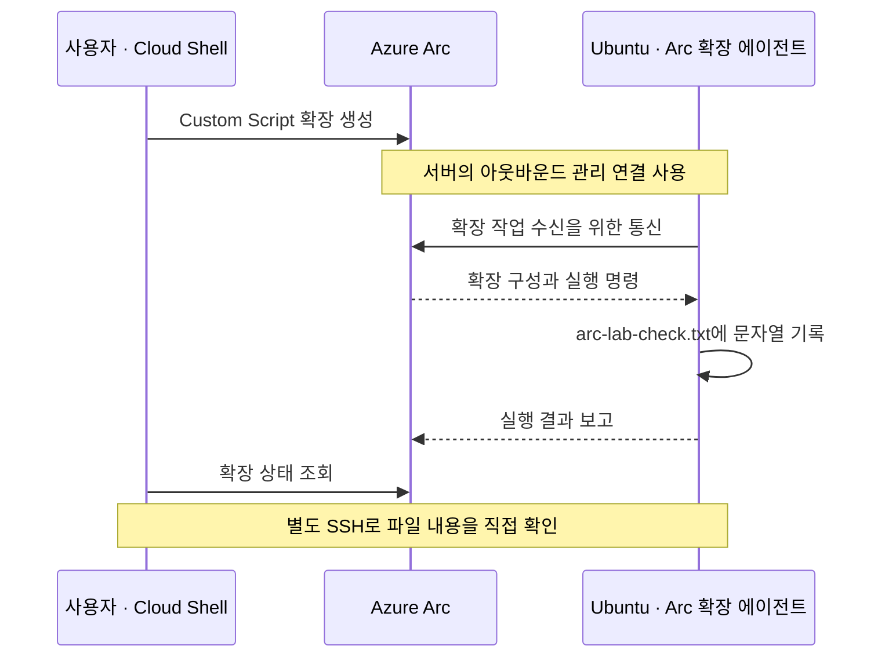

# 04–07. Azure Arc 등록·관리·정리 실습

> 목표 시간 50분. README에서 만든 같은 Ubuntu VM을 계속 사용하여 평가 환경을 준비하고,
> Arc 연결과 실제 확장 실행을 검증한 다음 정리합니다.

[시작 가이드](../README.md)의 전용 Ubuntu VM과 SSH 접속 확인을 마친 뒤 진행합니다.

⚠️ **주의**

**운영 VM에서는 실행하지 마세요.** Azure VM 확장과 Guest Agent를 비활성화하는
평가 전용 구성입니다. Guest Agent를 끈 뒤에는 Azure VM의 Run Command로 복구할 수 있다고 가정하면 안 됩니다.

## 목표와 진행 순서

| 모듈 | 할 일 | 완료 기준 | 목표 시간 |
| --- | --- | --- | ---: |
| 04 | [평가 환경 준비](#prepare): 1–3절 | SSH 유지, Guest Agent 비활성, IMDS 차단, 평가 변수 확인 | 15분 |
| 05 | [Arc 등록·기본 관리](#onboard): 4–5절 | `Connected`, 올바른 리소스 ID, 태그 저장 | 10분 |
| 06 | [확장 실습](#extension-lab): 6절 | 확장 `Succeeded`, 실제 파일 내용 확인, 확장 제거 | 15분 |
| 07 | [정리·운영 차이](#cleanup): 7절 이후 | Arc 서버와 전용 실습 자원 삭제, 운영 차이 이해 | 10분 |

앞 모듈을 건너뛰어 확장부터 설치하지 않습니다.
전체 흐름이나 용어가 낯설면 [00. Azure Arc 첫걸음](00-azure-arc-basics.md)을 먼저 읽습니다.

## 실행 위치와 읽는 방법

각 작업의 **👁️ 설명 → 🟢 실행 → 📋 확인**을 한 묶음으로 읽습니다.
앞 단계에서 성공했다는 사실과 현재 단계의 성공을 구분하며 실제 결과를 비교합니다.

| 표시 | 실행 위치 |
| --- | --- |
| PC / PowerShell | 내 Windows PC. SSH 접속과 파일 전송 |
| Ubuntu / Bash | `arcadmin`으로 VM에 SSH 접속한 터미널. sudo 사용 |
| Cloud Shell / Bash | Azure Portal 우측 상단 Cloud Shell. **Bash** 선택 |
| Portal | Azure Portal 화면 |

순서대로 진행하고, **명령이 실패하면 해당 단계에서 멈춥니다.**
여러 절의 명령을 한 번에 붙여 넣지 마세요. 이 문서는 배포 자동화 스크립트가 아닙니다.
실습에 사용할 구독·리전·IP를 직접 확인하며 꺾쇠 부분을 실제 값으로 바꿉니다.

핵심 합격 기준은 Arc `Connected`, 확장 `Succeeded`, VM 안의 `arc-lab-ok` 파일입니다.
현재 문서는 공식 문서 기반으로 작성되었으며 **실제 Azure 환경에서 끝까지 실행 검증하지 않았습니다.**

<a id="prepare"></a>
## 1. 실습 전 상태 확인

👁️ **설명**

모듈 04에서는 Azure VM의 관리 방식을 평가용으로 바꿉니다.
다른 실습에서 남은 에이전트나 방화벽 규칙을 그대로 사용하면 새 등록과 기존 등록을 혼동할 수 있습니다.
먼저 같은 전용 VM인지, 아직 Arc를 설치하지 않았는지 확인합니다.

🟢 **실행 — Ubuntu / Bash**

```bash
hostnamectl --static
command -v azcmagent
sudo ufw status verbose
```

📋 **확인**

호스트 이름은 `arc-lab-ubuntu-01`이어야 합니다. 이 이름을 Arc 서버 이름으로 사용합니다.
이름이 다르면 온보딩 스크립트의 대상 이름과 이후 명령을 먼저 일치시키세요.
새 VM에서는 `command -v azcmagent`가 아무 경로도 출력하지 않고 종료 코드 1을 반환합니다.
이는 이 단계에서만 정상인 **미설치 상태**입니다.
이미 설치되어 있거나 UFW가 기존 사용자 규칙으로 구성되어 있다면 기존 VM을 재사용하지 말고
전용 새 VM인지 확인하세요. Ubuntu 이미지에 UFW·curl이 없으면 먼저 패키지를 설치해야 합니다.

🟢 **실행 — Portal**

Portal의 **Azure Arc → 인프라 → 머신**에서 같은 구독·그룹·이름으로
등록된 서버가 없는지 확인합니다.

📋 **확인**

새 실습이라면 같은 이름의 Arc 서버가 아직 없는 것이 정상입니다.
이미 있다면 소유자를 확인하고 임의 삭제하지 않습니다.

## 2. Azure VM 확장 제거와 Guest Agent 비활성화

👁️ **설명**

Azure VM Guest Agent(`walinuxagent`)는 Azure VM 관리 기능이 OS 안에서 작업하도록 돕습니다.
Arc는 별도 Connected Machine Agent를 사용합니다.
평가 절차에서는 기존 VM 확장을 Arc가 이어받는다고 가정하지 않고,
**VM 확장 제거를 마친 뒤 Guest Agent를 중지**하여 두 관리 경로가 충돌하지 않게 합니다.
에이전트가 동작할 때 확장을 먼저 제거해야 제거 작업을 처리할 수 있습니다.

🟢 **실행 — Portal / Azure VM 리소스**

**Portal: Azure VM 리소스** `arc-lab-ubuntu-01`을 엽니다.
**설정 → 확장 + 애플리케이션**에서 Azure Monitor, Guest Attestation, Network Watcher 등
설치된 VM 확장을 모두 제거하고 작업 완료까지 기다립니다.
빈 목록이 확인되어야 다음 단계로 넘어갑니다.
정책이 다시 설치하거나 제거가 거부된다면 중단하고 관리자에게 문의합니다.

📋 **확인**

Azure VM의 확장 목록이 비어 있고 진행 중인 제거 작업이 없어야 합니다.
Arc 서버의 확장 목록을 확인하는 단계가 아닙니다.

🟢 **실행 — Ubuntu / Bash**

```bash
sudo systemctl stop walinuxagent
sudo systemctl disable walinuxagent
```

`stop`은 현재 서비스를 중지하고, `disable`은 부팅 시 자동 시작을 해제합니다.
현재 상태와 다음 부팅의 동작은 서로 다른 설정입니다.

🟢 **실행 — Ubuntu / Bash**

```bash
systemctl is-active walinuxagent
systemctl is-enabled walinuxagent
```

📋 **확인**

조회 결과는 각각 `inactive`, `disabled`여야 합니다.
이 상태 조회 명령은 비활성 상태에서 종료 코드가 0이 아닐 수 있습니다.
`Unit ... not found` 등은 같은 의미가 아니므로 다음 단계로 넘기지 않습니다.

앞으로 확장 실습은 **Azure VM 리소스가 아닌 Arc 서버 리소스**에서 수행합니다.
VM Guest Agent 비활성화는 VM 자체의 삭제나 전원 제어를 막지는 않습니다.

<a id="evaluation-settings"></a>
## 3. 평가 환경 변수와 방화벽 준비

### 3-1. 평가 환경 변수 설정

👁️ **설명**

`MSFT_ARC_TEST`는 Azure VM에서 평가 절차를 수행함을 알리는 환경 변수입니다.
`export`는 현재 Bash와 그 자식 프로세스에, `systemctl set-environment`는
systemd 관리자 환경에 설정합니다. 둘은 같은 대상이 아니므로 각각 확인합니다.

🟢 **실행 — Ubuntu / Bash**

```bash
export MSFT_ARC_TEST=true
sudo systemctl set-environment MSFT_ARC_TEST=true
printenv MSFT_ARC_TEST
sudo systemctl show-environment | grep '^MSFT_ARC_TEST='
```

📋 **확인**

각각 `true`, `MSFT_ARC_TEST=true`가 출력되어야 합니다.
이 설정은 현재 셸과 systemd 관리자 환경에 적용되며 재부팅 후 자동 유지된다고 가정하지 않습니다.
새 셸에서는 `export`를 다시 실행하고 온보딩 시에도 sudo에 변수를 전달합니다.

### 3-2. SSH를 유지하면서 IMDS만 차단

👁️ **설명**

IMDS는 Azure VM의 메타데이터와 관리 ID를 제공하는 서비스입니다.
평가 절차에서는 이 접근을 차단하여 Arc의 관리 표현과 혼동하지 않도록 합니다.
NSG와 달리 UFW는 Ubuntu 안의 방화벽입니다.
인터넷 아웃바운드는 유지하고, SSH 허용을 먼저 만든 다음 두 IMDS 주소를 차단합니다.

다음 변수에는 NSG에서 허용한 **내 PC의 공인 IPv4 `/32`** 를 넣습니다.
VM의 공인 IP나 예제 IP를 넣으면 안 됩니다.
`/32`는 단일 IPv4 주소만 가리키는 CIDR 표기입니다.

🟢 **실행 — Ubuntu / Bash**

```bash
LAB_CLIENT_IP='<YOUR_PUBLIC_IPV4>/32'
```

값을 확인한 후 다음 묶음을 실행합니다. `&&` 앞 명령이 실패하면 뒤 명령은 실행되지 않습니다.
활성화 전에 SSH 허용을 추가하며, Arc의 아웃바운드 통신은 유지합니다.

🟢 **실행 — Ubuntu / Bash**

```bash
sudo ufw default deny incoming &&
sudo ufw default allow outgoing &&
sudo ufw allow from "$LAB_CLIENT_IP" to any port 22 proto tcp &&
sudo ufw deny out to 169.254.169.254 &&
sudo ufw deny out to 169.254.169.253 &&
sudo ufw --force enable &&
sudo ufw status verbose
```

📋 **확인**

UFW `active`, SSH는 지정 IP만 허용, 두 주소 아웃바운드 차단이어야 합니다.
이 두 주소는 평가 안내에서 차단 대상으로 명시한 Azure/Azure Local IMDS 주소입니다.
차단 후 Azure VM의 관리 ID 기반 인증도 사용할 수 없으므로 이번 온보딩은 사용자 인증을 사용합니다.
`169.254.169.254` 차단을 인터넷·DNS 전체 차단으로 확대하지 마세요.

⚠️ **주의**

**기존 SSH 창을 닫지 않은 채 PC에서 두 번째 SSH 창을 열어 새 접속을 확인합니다.**
새 접속이 실패하면 기존 창에서 허용 IP와 UFW 규칙을 바로잡고 다시 검사하세요.
회사 공인 출구 IP가 다르면 NSG와 UFW를 같은 값으로 수정합니다.

### 3-3. 차단과 외부 통신을 따로 검증

👁️ **설명**

“IMDS에 연결할 수 없다”와 “인터넷 통신이 모두 끊겼다”는 다른 결과입니다.
프록시를 우회해 IMDS 두 주소를 검사한 다음 일반 HTTPS가 계속 동작하는지 확인합니다.

🟢 **실행 — Ubuntu / Bash**

```bash
for address in 169.254.169.254 169.254.169.253; do
  if curl --noproxy '*' --connect-timeout 2 --max-time 3 \
    -sS -o /dev/null "http://$address/metadata/instance?api-version=2021-02-01" \
    -H 'Metadata: true'; then
    printf 'FAIL: IMDS is reachable: %s\n' "$address"
    break
  else
    code=$?
    if [ "$code" -eq 7 ] || [ "$code" -eq 28 ]; then
      printf 'BLOCKED: %s (curl exit %s)\n' "$address" "$code"
    else
      printf 'FAIL: unexpected curl error %s for %s\n' "$code" "$address"
      break
    fi
  fi
done
```

📋 **확인**

**두 주소 모두 `BLOCKED`이고 UFW의 해당 deny 규칙이 확인**되어야 합니다.
HTTP 400/404 등 응답을 받은 것도 차단 성공이 아닙니다.
타임아웃만으로 방화벽 적용을 입증할 수 없으므로 UFW 상태를 함께 확인합니다.

🟢 **실행 — Ubuntu / Bash**

기본 외부 통신도 확인합니다.

```bash
getent hosts packages.microsoft.com
curl -I --connect-timeout 5 --max-time 15 https://packages.microsoft.com
```

📋 **확인**

DNS 해석과 정상 HTTPS 응답이 필요합니다. 이것만으로 모든 Arc 엔드포인트를
검증한 것은 아니며, 에이전트 설치 후 연결 검사도 수행합니다.

### 재부팅했다면

⚠️ **주의**

처음 실습은 불필요한 재부팅 없이 진행합니다. 중간에 재부팅했다면 다시 SSH로 접속해
2절의 Guest Agent 상태, 3절의 UFW와 IMDS 차단을 확인하고 **평가 환경 변수를 재설정**합니다.
UFW 규칙은 저장되지만 실제 활성 상태는 다시 확인해야 합니다.
비영구 `iptables` 규칙만 임시로 넣는 방식으로 대체하지 마세요.
재접속 경로를 잃었다면 확장·Run Command 복구를 시도하기보다 실습 VM을 새로 준비하는 편이 단순합니다.
기존 실패 리소스의 정리도 빠뜨리지 마세요.

### 모듈 04 완료 체크

- [ ] Azure VM 확장이 없고 `walinuxagent`가 `inactive`·`disabled`입니다.
- [ ] 현재 셸과 systemd의 평가 환경 변수를 확인했습니다.
- [ ] 새 SSH 연결을 열어도 접속되고 IMDS 두 주소만 차단됩니다.
- [ ] 외부 패키지 저장소의 DNS·HTTPS는 계속 동작합니다.

<a id="onboard"></a>
## 4. Portal에서 온보딩 스크립트 생성

👁️ **설명**

모듈 05에서는 준비한 Ubuntu를 Arc의 관리 대상으로 등록합니다.
Portal이 생성한 스크립트는 에이전트를 설치하고 선택한 구독·그룹·리전에 연결합니다.
사용자 인증은 등록 작업을 승인하기 위한 것이며, SSH 개인 키를 Azure로 보내는 과정이 아닙니다.
`sudo`는 OS의 설치 권한, Microsoft 로그인은 Azure의 등록 권한이라는 차이가 있습니다.

🟢 **실행 — Portal**

1. **Azure Arc → 인프라 → 머신 → 온보딩/만들기 → 기존 머신 온보딩**을 선택합니다.
2. VM을 만든 구독, `rg-arc-lab-01`, **Linux**를 선택합니다.
3. Arc 서버 메타데이터를 보관할 **Arc 지원 리전**을 선택해 기록합니다.
   이 값은 VM 또는 리소스 그룹 리전과 다를 수 있으며 이후 확장 명령에는 Arc 리전을 사용합니다.
4. **공용 엔드포인트**, **머신 수동 인증**을 선택합니다.
   이번에는 Private Link, Arc Gateway, 프록시를 새로 구성하지 않습니다.
5. 모니터링·보안·업데이트 등 유료 기능 활성화 옵션을 선택하지 않습니다.
   기본 선택이 있으면 검토하고, 강제 활성화라면 중단합니다.
6. `OnboardingScript.sh`를 **저장소 밖**, 예를 들어 사용자 Downloads 폴더에 내려받습니다.
   실행 전 텍스트 편집기로 구독·리소스 그룹·리전·설치 주소와 인증 방식을 확인합니다.
   VM Guest Agent가 아니라 Arc 에이전트를 설치하는 스크립트인지 확인합니다.

📋 **확인**

대상이 Linux이며 구독·그룹·Arc 리전이 실습의 선택값과 같습니다.
실제 사용할 스크립트를 검토한 뒤에만 다음 파일 전송을 수행합니다.

🟢 **실행 — PC / PowerShell**

PC에서 SSH로 복사합니다. 새 PowerShell 창에서도 실행하도록 접속 변수를 다시 지정합니다.

```powershell
$VmPublicIp = '<VM_PUBLIC_IP>'
$PrivateKeyPath = "$HOME\.ssh\<PRIVATE_KEY_FILE>"
scp -i $PrivateKeyPath "$HOME\Downloads\OnboardingScript.sh" "arcadmin@${VmPublicIp}:OnboardingScript.sh"
```

파일 위치가 다르면 실제 경로로 바꿉니다.
다운로드한 스크립트에는 환경별 식별자가 들어갈 수 있으므로 Git에 넣지 않습니다.

🟢 **실행 — Ubuntu / Bash**

```bash
sudo env MSFT_ARC_TEST=true bash ./OnboardingScript.sh
```

`sudo`는 환경 변수를 그대로 유지하지 않을 수 있어 `env`로 평가 변수를 명시적으로 전달합니다.
앞서 systemd에 설정한 변수도 유지되어 있는지 확인하세요.

⚠️ **주의**

실행 중 표시되는 Microsoft 로그인 주소를 **내 PC 브라우저**에서 열고 코드를 입력합니다.
현재 실행한 스크립트가 직접 출력한 코드만 사용하고, 계정·테넌트·구독이 맞는지 확인하세요.
조건부 액세스가 디바이스 코드 인증을 막으면 보안 정책을 우회하지 말고 관리자와 확인합니다.
새 서비스 주체·클라이언트 비밀을 만들어 우회하는 단계는 이 실습에 없습니다.

📋 **확인**

에이전트 설치와 Arc 연결 성공을 확인합니다. 실패하면 다음 절에서 상태를 확인하되
등록 성공으로 처리하지 않습니다. 재실행 전 기존 Arc 리소스가 생성됐는지 확인합니다.

## 5. 연결 확인과 기본 관리

### 5-1. 에이전트와 Portal의 같은 서버 확인

👁️ **설명**

등록 성공 메시지만 보고 끝내지 않고 **OS 안의 에이전트 상태와 Azure의 리소스**를 비교합니다.
같은 이름이 다른 구독에도 있을 수 있으므로 이름뿐 아니라 리소스 ID까지 확인합니다.
`Connected`는 관리 연결 상태이지 애플리케이션의 정상 동작이나 모든 확장의 성공을 의미하지 않습니다.

🟢 **실행 — Ubuntu / Bash**

```bash
sudo azcmagent show
```

📋 **확인**

**Arc 연결 상태 `Connected`**, 리소스 이름 `arc-lab-ubuntu-01`,
구독·리소스 그룹·리전이 앞서 선택한 값과 같은지 확인합니다.
Portal에서도 Azure VM이 아닌 **Azure Arc의 머신**을 열고 `Connected`인지 확인합니다.
OS와 에이전트 버전을 살펴봅니다. 새 등록 후 화면 반영에는 시간이 걸릴 수 있습니다.

| 확인값 | 기대하는 내용 |
| --- | --- |
| 상태 | 에이전트와 Portal 모두 `Connected` |
| 리소스 이름 | `arc-lab-ubuntu-01` |
| 리소스 ID | 선택한 구독·`rg-arc-lab-01`·`Microsoft.HybridCompute/machines` 경로 |
| OS·에이전트 | Ubuntu 정보와 설치된 에이전트 버전 표시 |

🟢 **실행 — Ubuntu / Bash / 연결 오류가 있을 때만**

실제 Arc 리전으로 검사합니다.

```bash
sudo azcmagent check --location '<ARC_REGION>'
sudo tail -n 80 /var/opt/azcmagent/log/azcmagent.log
```

단일 사이트 HTTPS 성공과 달리 이 검사는 Arc 연결에 필요한 엔드포인트를 확인합니다.
오류는 방화벽·프록시·DNS, 대상 리전, 테넌트·권한으로 나누어 확인하세요.
에이전트 로그는 로컬에서 검토하고 식별자·인증 정보가 담긴 원문을 그대로 공유하지 마세요.

### 5-2. 태그를 저장하고 다시 조회

👁️ **설명**

태그는 리소스에 붙이는 이름·값의 표식입니다.
예를 들어 `lab=arc-test-01`은 이번 실습 대상으로 분류하는 데 쓸 수 있습니다.
이 작업은 Azure의 관리 정보 변경이며 Ubuntu 안에서 명령을 실행하는 단계는 아닙니다.

🟢 **실행 — Portal / Arc 서버 리소스**

**Portal: Arc 머신 → 태그**에서 `lab=arc-test-01`을 추가하고 저장합니다.

📋 **확인**

페이지를 다시 열어 태그가 유지되는지 확인합니다.
태그는 Azure 리소스 메타데이터 변경입니다. 이것만으로 게스트 OS 안의 명령 실행을 검증한 것은 아닙니다.

### 모듈 05 완료 체크

- [ ] Portal의 Azure VM과 Arc 머신을 구분하여 열었습니다.
- [ ] `Connected`, 리소스 ID, OS·에이전트 버전을 확인했습니다.
- [ ] Arc 서버의 `lab=arc-test-01` 태그가 다시 열어도 유지됩니다.

<a id="extension-lab"></a>
## 6. Arc 확장으로 파일 생성

### 6-1. 실행 경로 이해

👁️ **설명**

모듈 06에서는 태그를 바꾸는 것보다 한 단계 더 나아가 **Ubuntu 안에서 실제 변경**을 수행합니다.
Custom Script 확장은 Arc의 확장 관리 경로로 명령을 전달하고 OS에서 실행합니다.
꺼 둔 Azure VM Guest Agent를 다시 켜거나 `az vm extension create`로 대체하지 않습니다.



Linux Custom Script v2는 Ubuntu 24.04를 지원하며,
publisher는 `Microsoft.Azure.Extensions`, type은 `CustomScript`입니다.
기본 Custom Script 관리는 [Arc 기본 제어 영역 요금][pricing]에서 무료로 안내되지만,
VM 등 기반 리소스 과금은 계속됩니다. 별도 Log Analytics, Storage, 유료 관리 서비스를 만들지 않습니다.

아래는 설정을 정확히 입력하기 위해 **Cloud Shell / Bash**를 사용합니다.
새 세션은 가능하면 저장소를 연결하지 않는 임시 세션으로 엽니다.
지속 스토리지를 새로 만들면 별도 비용과 정리 대상이 생깁니다.
이 명령을 Ubuntu SSH 창이나 Windows PowerShell에 붙여 넣지 마세요.

<a id="cloud-shell-setup"></a>
### 6-2. Cloud Shell 공통 준비와 세션 복구

🟢 **실행 — Cloud Shell / Bash**

```bash
SUBSCRIPTION_ID='<YOUR_SUBSCRIPTION_ID>'
RG='rg-arc-lab-01'
MACHINE='arc-lab-ubuntu-01'
ARC_REGION='<YOUR_ARC_REGION>'
az account set --subscription "$SUBSCRIPTION_ID"
```

📋 **확인**

`az account set`이 오류 없이 끝나야 합니다.
이 변수들은 Cloud Shell을 새로 열면 자동 복구되지 않습니다.
세션이 끊겼다면 같은 구독·그룹·머신·Arc 리전으로 이 절부터 다시 준비하고,
이미 만든 확장을 생성 명령으로 덮어쓰지 말고 아래의 조회 명령부터 확인합니다.

🟢 **실행 — Cloud Shell / Bash**

계정을 확인하고 필요한 Azure CLI 확장을 준비합니다.
현재 CLI 참조 문서의 최소 버전은 **2.75.0**입니다.
온보딩에 사용한 `azcmagent`와 관리 PC의 `az connectedmachine`은 다른 도구입니다.

```bash
az version
az account show --query '{subscription:id,tenant:tenantId}' -o json
az extension add --name connectedmachine --upgrade
az connectedmachine show --resource-group "$RG" --name "$MACHINE" \
  --query '{id:id,location:location,status:status}' -o json
```

📋 **확인**

출력의 구독과 머신이 맞고 `location`이 `$ARC_REGION`과 같아야 합니다.
오류 또는 다른 대상이면 여기서 멈춥니다.

### 6-3. 지역별 확장 이미지 확인

👁️ **설명**

확장의 publisher는 배포자, type은 확장 종류, handler version은 설치할 처리기의 버전입니다.
이미지 지원 여부는 Arc 리전별로 확인합니다. Ubuntu 버전 지원과 지역별 제공 여부는 서로 다른 조건입니다.

🟢 **실행 — Cloud Shell / Bash**

지역에 제공되는 Arc 확장 이미지를 조회합니다. Azure VM 확장 배포 명령은 사용하지 않습니다.

```bash
az connectedmachine extension image list \
  --location "$ARC_REGION" \
  --publisher Microsoft.Azure.Extensions \
  --extension-type CustomScript -o json
```

📋 **확인**

공식 Linux Custom Script v2 문서의 handler 예시는 `2.1`입니다.
조회 결과에도 해당 계열 버전이 제공되는지 확인합니다.
목록이 비거나 `2.1` 계열을 확인할 수 없으면 임의 버전을 추측하지 말고 지원 리전·확장을 확인하세요.

### 6-4. 실제 변경과 결과 확인

👁️ **설명**

명령은 `/var/tmp/arc-lab-check.txt`에 `arc-lab-ok` 한 줄을 기록합니다.
비밀이나 업무 데이터가 없는 검증용 파일이며, 성공 여부를 SSH에서도 비교할 수 있습니다.
`Succeeded`는 Azure 쪽의 배포 결과, 파일 내용은 게스트 OS 쪽의 실행 결과입니다.
두 결과를 모두 확인해야 이번 실습의 관리 경로를 검증한 것입니다.

⚠️ **주의**

다음은 **Arc 확장을 생성하여 root 권한으로 파일을 기록하는 변경 작업**입니다.
대상 머신을 다시 확인하고 실행합니다.

🟢 **실행 — Cloud Shell / Bash**

```bash
az connectedmachine extension create \
  --resource-group "$RG" --machine-name "$MACHINE" \
  --name arc-lab-custom-script --location "$ARC_REGION" \
  --publisher Microsoft.Azure.Extensions --type CustomScript \
  --type-handler-version 2.1 --auto-upgrade-minor-version true \
  --settings '{"commandToExecute":"printf \"arc-lab-ok\\n\" > /var/tmp/arc-lab-check.txt"}'
```

`commandToExecute`는 단순한 로컬 파일 기록뿐이며 외부 스크립트를 다운로드하지 않습니다.
공개 settings에 비밀을 넣지 마세요. 완료 후 상태를 조회합니다.

🟢 **실행 — Cloud Shell / Bash**

```bash
az connectedmachine extension show \
  --resource-group "$RG" --machine-name "$MACHINE" \
  --name arc-lab-custom-script -o json
```

📋 **확인 — Azure 쪽 결과**

`provisioningState`가 `Succeeded`여야 합니다.
진행 중이면 완료 후 다시 조회하고, `Failed`라면 instance view의 오류를 확인합니다.

🟢 **실행 — Ubuntu / Bash**

이어서 SSH로 접속한 Ubuntu에서 파일 내용을 확인합니다.

```bash
cat /var/tmp/arc-lab-check.txt
```

📋 **확인 — OS 쪽 결과**

`arc-lab-ok`가 출력되어야 합니다.
Portal → Arc 확장 → VM 안의 파일이라는 관리 경로가 작동했습니다.
파일이 없으면 Ubuntu에서 직접 만들어 성공한 것처럼 처리하지 마세요.

### 6-5. 확장 제거와 산출물 수명

👁️ **설명**

확장 설치·제거와 명령이 만든 파일의 수명은 다릅니다.
확장 제거가 자동 롤백을 의미하지 않는다는 점을 확인합니다.

🟢 **실행 — Cloud Shell / Bash**

```bash
az connectedmachine extension delete \
  --resource-group "$RG" --machine-name "$MACHINE" \
  --name arc-lab-custom-script
```

삭제 확인을 요청하면 대상을 확인하고 승인합니다. 성공한 뒤 목록을 조회합니다.

🟢 **실행 — Cloud Shell / Bash**

```bash
az connectedmachine extension list \
  --resource-group "$RG" --machine-name "$MACHINE" -o json
```

📋 **확인**

목록에서 `arc-lab-custom-script`가 없어야 합니다.
**확장 제거가 실행 결과까지 되돌리지는 않습니다.** 파일은 남을 수 있으며 VM 삭제 시 함께 제거됩니다.
다른 확장이 남아 있다면 정책에 의한 설치인지 확인하고 다음 정리 전에 원인을 파악합니다.

### 모듈 06 완료 체크

- [ ] 구독·그룹·머신·Arc 리전이 실습 대상과 일치했습니다.
- [ ] Arc 확장 `Succeeded`와 SSH의 `arc-lab-ok` 출력을 모두 확인했습니다.
- [ ] 확장 제거 후 목록에서 사라졌으며 파일은 별도로 남을 수 있음을 이해했습니다.

<a id="cleanup"></a>
## 7. 연결 해제와 리소스 정리

👁️ **설명**

모듈 07에서는 **확장 제거 → Arc 연결 해제 → 전용 그룹 삭제 → 잔존 자원 확인** 순서로 정리합니다.
컴퓨터를 끄는 것, Arc 등록을 지우는 것, 과금 자원을 지우는 것은 같은 작업이 아닙니다.
이번에 만든 전용 그룹만 대상으로 확인하면 다른 실습이나 운영 자원을 건드릴 위험을 줄일 수 있습니다.

⚠️ **주의**

중간에 실패해도 생성된 리소스는 자동 삭제되지 않습니다.
다음 절차는 **이번에 만든 전용 실습 리소스만** 대상으로 합니다.
공유 리소스 그룹이나 다른 사람의 VM은 삭제하지 마세요.

🟢 **실행 — Ubuntu / Bash와 Portal, 단계마다 위치 확인**

1. 설치된 Arc 확장을 먼저 제거합니다. 6절에서 제거했다면 목록으로 확인합니다.
2. **Ubuntu / Bash**에서 다음을 실행합니다.

   ```bash
   sudo azcmagent disconnect
   sudo azcmagent show
   ```

   같은 테넌트의 계정으로 로그인하고 연결 해제 성공을 확인합니다.
   `disconnect`는 클라우드 Arc 서버 리소스를 삭제하고 로컬 등록을 초기화합니다.
   로컬 에이전트 프로그램 자체를 제거하는 명령은 아닙니다.
   VM을 바로 삭제하므로 별도 패키지 제거는 이번 실습에서 생략합니다.
3. **Portal → Azure Arc → 머신**에서 해당 구독·그룹의 Arc 서버가 사라졌는지 확인합니다.
   오류나 권한 부족이면 해제됐다고 가정하지 말고 관리자에게 삭제를 요청합니다.
   `--force-local-only`는 클라우드 리소스를 삭제하지 않으므로 일반 정리 대안으로 쓰지 않습니다.
4. **Portal → 리소스 그룹 → `rg-arc-lab-01`**에서 포함 자원을 확인합니다.
   실습 자원만 있는지와 구독을 다시 확인한 뒤 **리소스 그룹 삭제**를 선택하고
   그룹 이름을 입력하여 승인합니다. 복구가 필요한 데이터가 없는지도 확인합니다.
5. 삭제 완료 후 모든 리소스에서 `arc-lab-ubuntu-01`과 실습 그룹을 검색하여
   **Arc 서버, VM, OS 디스크, NIC, NSG, VNet, 공인 IP**가 남지 않았는지 확인합니다.
   Arc를 다른 그룹에 잘못 등록했다면 그 리소스도 별도로 소유권을 확인하여 정리합니다.

📋 **확인**

| 정리 대상 | 확인 기준 |
| --- | --- |
| Arc 확장 | 삭제 성공, 머신의 확장 목록에서 사라짐 |
| Arc 서버 | 같은 구독·그룹의 Arc 머신 목록에서 사라짐 |
| 전용 실습 그룹 | 삭제 완료 |
| VM·OS 디스크·NIC·NSG·VNet·공인 IP | 이번 실습의 자원이 남아 있지 않음 |
| 별도 Cloud Shell 스토리지 | 만들었다면 공유 여부 확인 후 따로 처리 |

등록 전 실패했다면 `azcmagent disconnect`가 필요 없거나 실행할 수 없을 수 있습니다.
클라우드 Arc 리소스 생성 여부부터 확인하고, 생성됐다면 관리자와 삭제한 뒤
전용 실습 그룹을 정리합니다.

VM을 게스트 OS에서 종료하거나 Portal에서 할당 해제하는 것만으로 정리를 끝내지 마세요.
디스크·공인 IP 요금은 남을 수 있습니다. Cost Management 사용량 반영은 지연될 수 있으며,
삭제 직후 청구 화면이 0이 아니라고 해서 삭제 실패인 것은 아닙니다.
Cloud Shell용 스토리지 등을 별도로 만들었다면 공유 여부를 확인한 후 별도 정리합니다.

<a id="production-differences"></a>
### 운영 환경으로 확장할 때 달라지는 점

👁️ **설명**

이번 실습의 목적은 Arc의 관리 경로를 이해하는 것입니다.
실습에 성공했다고 운영 환경의 보안·가용성·비용 관리가 완성되는 것은 아닙니다.

| 구분 | 이번 실습 | 운영 적용 시 검토 |
| --- | --- | --- |
| 서버 위치 | Azure VM을 외부 서버처럼 준비 | 실제 온프레미스·다른 클라우드의 지원 OS |
| 평가 우회 설정 | Guest Agent 비활성화, IMDS 차단, 평가 변수 | Azure VM 전용 테스트 절차를 외부 서버에 그대로 적용하지 않기 |
| 접근 경로 | 실습자 IP 제한 공인 SSH | 조직의 관리망·접속 통제·감사 요구사항에 맞게 설계 |
| Arc 통신 | 공용 엔드포인트 아웃바운드 | 방화벽·프록시·Private Link·Arc Gateway 필요성 평가 |
| 권한과 인증 | 사용자 수동 등록과 전용 그룹 | 최소 권한, 관리 ID·온보딩 방식, 자격 증명 수명 관리 |
| 상태 검증 | 연결·태그·파일 생성 한 번 확인 | 모니터링·에이전트 업데이트·장애 대응·복구 절차 |
| 부가 관리 | 유료 관리 서비스를 새로 켜지 않음 | Policy·Monitor·Defender·Update Manager의 필요성·요금·정책 |
| 자원 수명 | 실습 후 전용 그룹 삭제 | 등록 해제·폐기 절차, 데이터 보존, 운영 변경 승인 |

이 표는 운영 설계 검토의 출발점이지 운영 적합성 인증이나 구축 자동화 도구가 아닙니다.

<a id="troubleshooting"></a>
## 8. 문제가 생겼을 때

👁️ **설명**

아래 표로 실패 지점을 먼저 구분합니다.
로그인 실패를 네트워크 개방으로 해결하거나, 파일을 직접 만들어 확장 성공으로 처리하지 않습니다.
이미 생성한 자원이 있다면 쓰기 명령을 반복하기 전에 읽기 전용 상태 조회부터 수행합니다.

| 증상 | 확인할 내용 |
| --- | --- |
| Azure VM에는 지원되지 않는다는 설치 오류 | 평가 변수의 sudo 전달, systemd 환경, 두 IMDS 차단, 기존 확장·Guest Agent 제거 순서 |
| SSH 시간 초과 | VM 전원·공인 IP, 실제 PC 출구 IP와 NSG·UFW `/32` 일치 여부 |
| Arc `Disconnected` | `azcmagent check`, DNS·필수 HTTPS, 프록시, 리전, 시스템 시간 |
| 로그인·권한 오류 | 같은 테넌트·구독인지, 온보딩 역할과 확장·삭제 권한의 차이, 조건부 액세스 |
| 확장 배포 실패 | Arc 연결, 지역별 이미지·handler 제공 여부, Arc extension instance view, 구독 정책 |
| 삭제 권한 부족·정책 재설치 | 오류를 남기고 관리자에게 요청. `force-local-only` 또는 보안 정책 우회로 숨기지 않기 |

## 전체 완료 체크

- [ ] Azure VM과 Arc 서버가 서로 다른 관리 리소스임을 설명할 수 있다.
- [ ] Arc `Connected`와 등록 대상 ID를 확인했다.
- [ ] Arc 리소스의 태그 저장을 확인했다.
- [ ] 확장 `Succeeded`와 VM 안의 `arc-lab-ok` 출력을 확인했다.
- [ ] 확장 제거, Arc 연결 해제, 전용 그룹과 잔존 자원 삭제를 확인했다.
- [ ] 이번 평가용 구성과 실제 외부 서버의 운영 구성이 다름을 설명할 수 있다.

## 다음 단계

- [워크숍 전체 흐름과 비용](../README.md)
- [개념 다시 보기: 00. Azure Arc 첫걸음](00-azure-arc-basics.md)
- [운영 적용 시 검토할 차이](#production-differences)

## 공식 참고 자료

- [Azure VM 평가 전용 절차](https://learn.microsoft.com/en-us/azure/azure-arc/servers/plan-evaluate-on-azure-virtual-machine)
- [Portal 온보딩](https://learn.microsoft.com/en-us/azure/azure-arc/servers/onboard-portal)
- [Arc 네트워크 요구 사항](https://learn.microsoft.com/en-us/azure/azure-arc/servers/network-requirements)
- [Arc Linux 확장 목록](https://learn.microsoft.com/en-us/azure/azure-arc/servers/manage-vm-extensions#linux-extensions)
- [Custom Script v2 지원 OS와 스키마](https://learn.microsoft.com/en-us/azure/virtual-machines/extensions/custom-script-linux)
- [Arc 확장 CLI](https://learn.microsoft.com/en-us/cli/azure/connectedmachine/extension)
- [Arc 지역별 확장 이미지 조회](https://learn.microsoft.com/en-us/cli/azure/connectedmachine/extension/image)
- [연결 해제의 동작과 인증](https://learn.microsoft.com/en-us/azure/azure-arc/servers/azcmagent-disconnect)

[pricing]: https://azure.microsoft.com/en-us/pricing/details/azure-arc/
